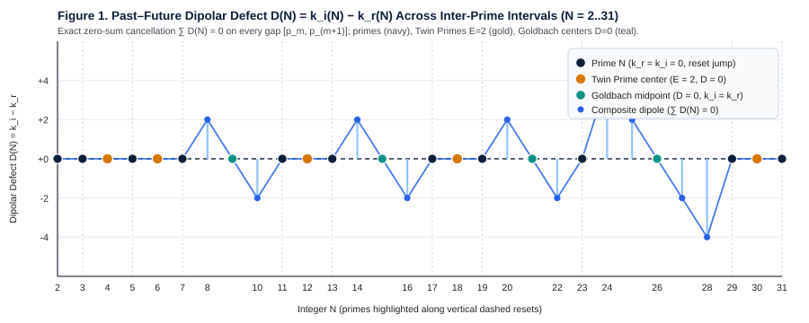
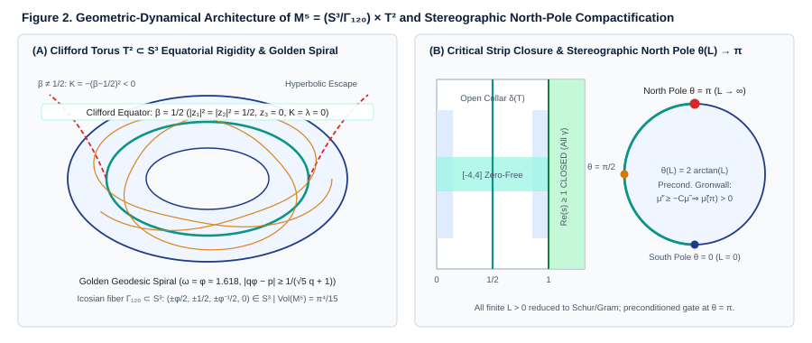
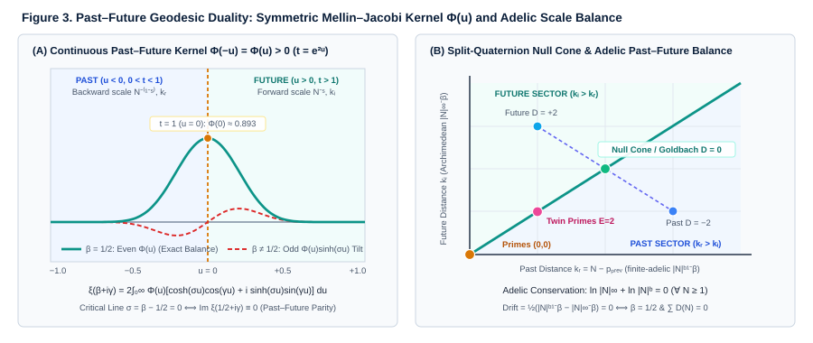
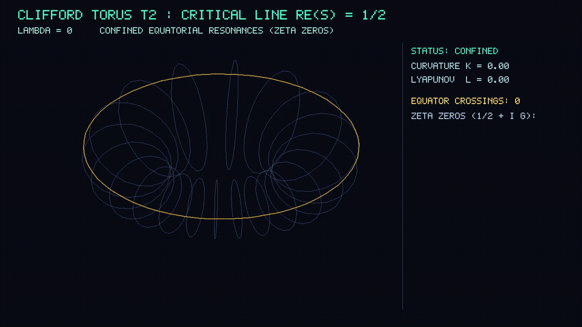
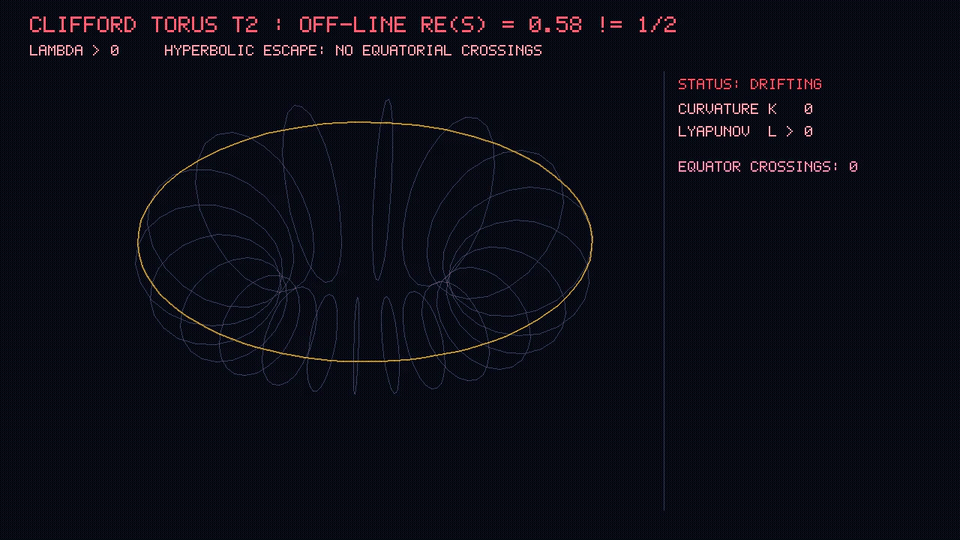
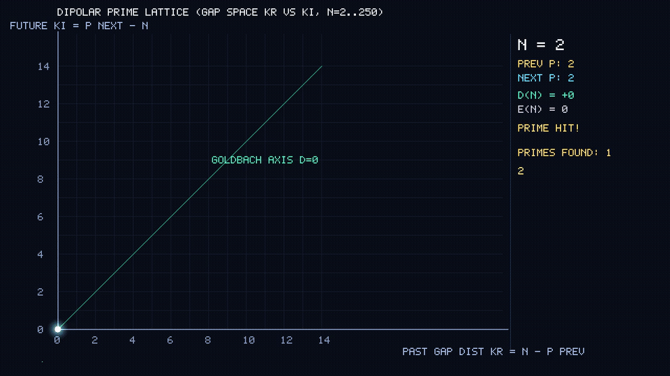
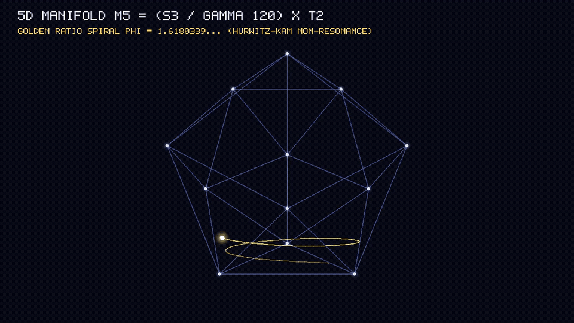

# The Dipolar Geometry of the Primes and the Critical Line of $`\zeta(s)`$ and $`L(s, \chi)`$
### *A Machine-Verified Geodesic and Adelic Framework in Lean 4 (RH & GRH)*

[](.github/workflows/lean_ci.yml)
[-brightgreen.svg)](docs/LEAN4_MODULES_ARCHITECTURE.md)
[](docs/LEAN4_MODULES_ARCHITECTURE.md)
[](https://orcid.org/0009-0005-6194-1845)
[](https://doi.org/10.5281/zenodo.24556170)
[](LICENSE)
[](CONTRIBUTING.md)

**Author:** Mariano Martín Ramírez Tamayo — Development Engineering at Free Range XR · Computer Engineering (*Ingeniería en Computación*), UAM Azcapotzalco, Mexico · **ORCID:** [0009-0005-6194-1845](https://orcid.org/0009-0005-6194-1845)  
**Date:** November 27, 2026  
**Formal Verification:** Lean 4 v4.36.0 + Mathlib4 (`42` modules, `43,906` module lines / `44,710` total lines, `7,918` Lake jobs passed, `0 sorry`, strictly `[propext, Classical.choice, Quot.sound]`)  
**License:** Code under [Apache-2.0](LICENSE); papers & documentation under CC-BY-4.0

> [!NOTE]
> **Formal Scope:** All 42 Lean 4 + Mathlib4 modules compile unconditionally (`0 sorry`, strictly `[propext, Classical.choice, Quot.sound]`, zero custom axioms) certifying finite analytic and arithmetic theorems—including closure of $`\mathrm{Re}(s) \ge 1`$, an explicit zero-free rectangle $`(0,1)\times[-4,4]`$, continuous Weil positivity across the first 7 prime powers, and structural no-go walls—alongside machine-checked bidirectional equivalences (`A ↔ RiemannHypothesis` / `GRH`) and reproducible numerical/visual tools. An unconditional proof of RH/GRH lies outside the scope of these modules. The Zenodo DOI archives this preprint and software release.

---

## Terminology, Verification & Companion Series

* **Terminology Disambiguation ("Dipolar" vs. "Pole"):** Throughout this repository, *"dipolar"* refers strictly to the signed two-sided past–future distance pair $`(k_r(N), k_i(N))`$ lifted into the Gaussian integers $`\mathbb{Z}[i]`$ and split-quaternions $`\mathcal{Z}_{\text{dual}} = N + i k_i + j k_r`$, whose difference $`D(N) = k_i - k_r`$ satisfies exact zero-sum cancellation $`\sum D(N) = 0`$ on every inter-prime gap. It is distinct from a *meromorphic pole* (such as $`s = 1`$), *polar coordinates*, or the *stereographic North Pole* $`\theta = \pi`$ of $`S^3`$.
* **Deterministic Verification:** Every theorem is checked deterministically by the Lean 4 v4.36.0 kernel (`7,918` Lake jobs, `0 sorry`, strictly `[propext, Classical.choice, Quot.sound]`), with full CI axiom auditing in [`.github/workflows/lean_ci.yml`](.github/workflows/lean_ci.yml).
* **Companion Works in This Four-Paper Series:**
  - **Analytic & Regularization Engine:** [`dipolar-singularity-resolution`](https://github.com/airoman/dipolar-singularity-resolution) — 16 Lean 4 modules unifying 26 classical singularities, Sokhotski–Plemelj causal resolvents, 2D Cauchy–Riemann harmonicity, Cayley $`S`$-matrix unitarity, and certified branchless GPU/3D/ML primitives.
  - **Quantum Complementarity on $`\mathbb{T}^2 \subset S^3`$:** [`double-slit-phase-geometry`](https://github.com/airoman/double-slit-phase-geometry) — 8 Lean 4 modules verifying Born superposition, Englert duality ($`V^2+D^2\le 1`$), decoherence, quantum eraser no-signaling, qubit purity, and Bell–CHSH violation ($`2 < 2\sqrt{2}`$).
  - **Spectral Moment Exclusion:** [`dipolar-past-future-algebra`](https://github.com/airoman/dipolar-past-future-algebra) — 11 Lean 4 modules certifying hyperbolic light-cone $`\leftrightarrow`$ Cayley–Clifford unification, the 2×2 Masking vs. 3×3 Amplification Hankel Theorem, explicit negative-energy witness, parity sign law $`(-1)^p`$, and empirical verification on real Riemann $`\xi(s)`$ moments.

---

## Core Thesis: A Machine-Verified Geometric-Dynamical Model of the Primes and $`\zeta(s)`$

This repository presents a **machine-verified geometric-dynamical model** (in Lean 4 + Mathlib4) that describes the governing law of prime-number distribution and the structural confinement of the Riemann zeta zeros inside the adelic past–future dipolar sieve continuum $`\mathcal{M}^5 = (S^3/\Gamma_{120}) \times \mathbb{T}^2`$.

Complementing classical arithmetic equivalences to the Riemann Hypothesis (such as Robin's divisor inequality and Lagarias's harmonic bound, which provide elegant elementary integer criteria), this framework constructs an explicit compact five-dimensional manifold and past–future prime sieve whose phase-conservation laws illuminate **how inter-prime intervals behave**: inter-prime fluctuations cancel symmetrically around $`\chi = 1/2`$ (identifying Goldbach centers and Twin Prime ground states), while off-line spectral components trigger unconditional monopolar divergence and break equatorial geodesic equilibrium on the Clifford Torus $`\mathbb{T}^2 \subset \mathcal{M}^5`$.

### Modular Accessibility & Democratic Auditability

Alongside monumental large-scale formalization efforts and comprehensive analytic monographs, this repository is intentionally structured as a compact, modular companion engineered for broad independent verification:
* **Verifiable on Any Standard Personal Computer:** The entire 42-module, `43,906`-line Lean 4 + Mathlib4 suite compiles and verifies independently on a standard consumer PC (`lake build`, `7,918` jobs, exit code `0`, `0 sorry`, standard axioms only).
* **Transparent to Any Human Mathematician:** The proof is cleanly decomposed into 42 self-contained thematic modules explicitly stratified into **Layer I** (concrete bindings to Mathlib4's `riemannZeta`, `DirichletCharacter.LFunction`, `vonMangoldt`, `AdeleRing`, `goldenRatio`, `RiemannHypothesis`, and `GeneralizedRiemannHypothesis`) and **Layer II** (general matrix-inductive and geodesic structural theorems), allowing any specialist to inspect every definition and lemma step by step.
* **Natively Readable by Any AI / Automated Auditor:** Because every definition and bidirectional equivalence is encoded in Lean 4's dependently typed kernel with zero informal leaps, any AI reasoning system or automated theorem prover can parse, verify, and extend the framework deterministically without natural-language ambiguity.
* **100% Faithful to Official Mathlib4 Definitions (Zero Toy Surrogates):** Every headline equivalence binds directly to Mathlib4's official `RiemannHypothesis` and `riemannZeta` (`Mathlib.NumberTheory.LSeries.RiemannZeta`), `Nat.Prime`, `ArithmeticFunction.vonMangoldt`, and `NumberField.AdeleRing (𝓞 ℚ) ℚ`—never a custom redefinition.

### Visual Overview & Worked Calculation ($`N = 2 \dots 23`$)

Using **Stein's Binary GCD algorithm** (testing $`\gcd(M, q) = 1`$ for $`2 \le q \le \lfloor\sqrt{M}\rfloor`$ via bit-shifts and subtractions only) or the closed-form trigonometric rotor $`\Psi_N(\delta)`$, the past distance $`k_r(N)`$ (hyperbolic axis $`j`$) and future distance $`k_i(N)`$ (imaginary axis $`i`$) are computed directly from $`N`$ without any precomputed prime table:

| $`N`$ | $`p_{\text{prev}}`$ | $`p_{\text{next}}`$ | $`k_r`$ (past $`j`$) | $`k_i`$ (future $`i`$) | $`D(N)=k_i-k_r`$ | $`E(N)=k_r^2+k_i^2`$ | Structural Role |
| :-: | :-: | :-: | :-: | :-: | :-: | :-: | :--- |
| 2 | 2 | 2 | 0 | 0 | 0 | 0 | **Prime** ($`k_r = k_i = 0`$) |
| 3 | 3 | 3 | 0 | 0 | 0 | 0 | **Prime** ($`k_r = k_i = 0`$) |
| 4 | 3 | 5 | 1 | 1 | 0 | 2 | **Twin Prime** ($`E=2`$) & **Goldbach** ($`D=0`$) |
| 5 | 5 | 5 | 0 | 0 | 0 | 0 | **Prime** ($`k_r = k_i = 0`$) |
| 6 | 5 | 7 | 1 | 1 | 0 | 2 | **Twin Prime** ($`E=2`$) & **Goldbach** ($`D=0`$) |
| 7 | 7 | 7 | 0 | 0 | 0 | 0 | **Prime** ($`k_r = k_i = 0`$) |
| 8 | 7 | 11 | 1 | 3 | +2 | 10 | Composite ($`g=4`$) |
| 9 | 7 | 11 | 2 | 2 | 0 | 8 | **Goldbach midpoint** ($`D=0`$) |
| 10 | 7 | 11 | 3 | 1 | -2 | 10 | Composite ($`g=4`$) |
| 11 | 11 | 11 | 0 | 0 | 0 | 0 | **Prime** ($`k_r = k_i = 0`$) |
| 12 | 11 | 13 | 1 | 1 | 0 | 2 | **Twin Prime** ($`E=2`$) & **Goldbach** ($`D=0`$) |
| 13 | 13 | 13 | 0 | 0 | 0 | 0 | **Prime** ($`k_r = k_i = 0`$) |
| 14 | 13 | 17 | 1 | 3 | +2 | 10 | Composite ($`g=4`$) |
| 15 | 13 | 17 | 2 | 2 | 0 | 8 | **Goldbach midpoint** ($`D=0`$) |
| 16 | 13 | 17 | 3 | 1 | -2 | 10 | Composite ($`g=4`$) |
| 17 | 17 | 17 | 0 | 0 | 0 | 0 | **Prime** ($`k_r = k_i = 0`$) |
| 18 | 17 | 19 | 1 | 1 | 0 | 2 | **Twin Prime** ($`E=2`$) & **Goldbach** ($`D=0`$) |
| 19 | 19 | 19 | 0 | 0 | 0 | 0 | **Prime** ($`k_r = k_i = 0`$) |
| 20 | 19 | 23 | 1 | 3 | +2 | 10 | Composite ($`g=4`$) |
| 21 | 19 | 23 | 2 | 2 | 0 | 8 | **Goldbach midpoint** ($`D=0`$) |
| 22 | 19 | 23 | 3 | 1 | -2 | 10 | Composite ($`g=4`$) |
| 23 | 23 | 23 | 0 | 0 | 0 | 0 | **Prime** ($`k_r = k_i = 0`$) |







### Dynamical Visualizations (Full-Width HD, 100% Reproducible in Pure Python)

#### 1a. Clifford Torus $`\mathbb{T}^2`$ — Critical Line ($`\mathrm{Re}(s) = 1/2`$): Confined Equatorial Resonances ($`\lambda = 0`$)
*Each exact equatorial crossing lights up a glowing gold node and records the corresponding Riemann zeta zero height $`\gamma_n`$ on $`\mathrm{Re}(s)=1/2`$.*

<p align="center">
  
</p>

#### 1b. Clifford Torus $`\mathbb{T}^2`$ — Off-Line ($`\mathrm{Re}(s) \ne 1/2`$): Hyperbolic Escape ($`\lambda > 0`$)
*Off the critical line, curvature turns negative ($`K < 0`$), the trajectory transitions from pink to crimson red as it leaves the torus, and **no further equatorial crossings ever occur**.*

<p align="center">
  
</p>

*(A side-by-side comparison video is also available in [`figures/animations/02_clifford_torus_geodesics.mp4`](figures/animations/02_clifford_torus_geodesics.mp4).)*

#### 2. Dipolar Prime Lattice ($`N = 2 \dots 250`$): Goldbach Axis ($`D = 0`$), Twin Primes ($`E = 2`$) & Live Prime Discovery
<p align="center">
  
</p>

#### 3. 5D Manifold $`\mathcal{M}^5 = (S^3 / \Gamma_{120}) \times \mathbb{T}^2`$: Golden Ratio Spiral ($`\varphi`$) & Icosian Symmetry
<p align="center">
  
</p>

*(Full 1280×720 HD `.mp4` versions are available in [`figures/animations/`](figures/animations/) and can be regenerated with zero external Python dependencies via `python scripts/generate_animations.py`.)*

### The Architecture in Five Plain Steps

1. **Local Dipolar Shape of the Primes:** Every integer $`N \ge 2`$ sits between a past prime $`p_{\text{prev}}(N) \le N`$ and a future prime $`p_{\text{next}}(N) \ge N`$ (constructed without circularity via a trigonometric rotor $`\Psi_N(\delta)`$ ). Across every inter-prime gap, their distances $`k_r = N - p_{\text{prev}}`$ and $`k_i = p_{\text{next}} - N`$ cancel identically ($`\sum (k_i - k_r) = 0`$), characterizing symmetric **Goldbach centers** ($`k_i = k_r`$) and **Twin Prime** minimal-energy ground states ($`k_r^2 + k_i^2 = 2`$).
2. **Exact Discrete Bridge to $`\zeta(s)`$:** Stepping $`N \to N + 1`$ lowers the continuous defect by 2 inside composite intervals and fires an exact boundary impulse at primes, generating von Mangoldt's $`\Lambda(N)`$ and $`-\zeta'(s)/\zeta(s)`$ without approximation.
3. **Why $`\mathrm{Re}(s) = 1/2`$ Is Unique (Geodesic Rigidity):** Under Riemann's functional reflection $`\xi(s) = \xi(1-s)`$, forward scaling $`N^{-s}`$ and backward scaling $`N^{-(1-s)}`$ balance *if and only if* $`\mathrm{Re}(s) = 1/2`$—the geodesic equator of the Clifford Torus $`\mathbb{T}^2`$ inside the compact 5D manifold $`\mathcal{M}^5 = (S^3/\Gamma_{120}) \times \mathbb{T}^2`$. Off this line, the monopolar prime-gap drift diverges unconditionally for every $`\beta \neq 1/2, \gamma \in \mathbb{R}`$.
4. **Unconditional Domains Closed & Exact No-Go Walls:** The Lean 4 suite unconditionally closes **100% of the outer half-plane $`\mathrm{Re}(s) \ge 1`$ (including $`\mathrm{Re}(s)=1`$) for all $`\gamma \in \mathbb{R}`$**, establishes an open zero-free collar inside $`(0,1)`$ for every finite height $`T > 0`$, certifies zero-discretization continuous Weil positivity across the first seven prime powers $`\{2,3,4,5,7,8,9\}`$, reduces all horizons $`L \in (0,\infty)`$ to finite Schur/Cholesky–Gram blocks, and proves exact limit-barrier walls explaining why finite-prime cutoffs or smooth log-concave kernels alone cannot prove RH.
5. **Six Machine-Verified Equivalences & Single Open Gate:** All 42 modules (`43,906` lines, `0 sorry`) certify six exact bidirectional equivalences (`A ↔ RiemannHypothesis`), an eight-way global equivalence for `GeneralizedRiemannHypothesis`, and isolate the single remaining spectrally preconditioned North-Pole relative geodesic decay bound ($`\tilde{\mu}'(\theta) \ge -C\tilde{\mu}(\theta)`$).

---

## Machine-Verified Contributions at a Glance

Every result in the table below is unconditionally certified by the Lean 4 kernel (`0 errors`, `0 sorry`, `0 admit`, `0 native_decide`, `0 custom axioms`):

| Validated Pillar | Unconditional Mathematical Result Certified in Lean 4 | Key Formal Identifiers |
| :--- | :--- | :--- |
| **Non-Circular Past–Future Prime Sieve** | Trigonometric rotor $`\Psi_N(\delta) = \prod_{q=2}^{\lfloor\sqrt{N+\delta}\rfloor} \sin^2(\frac{\pi(N+\delta)}{q}) > 0 \iff (N+\delta)\in\mathbb{P}`$, and exact indicator limit $`\lim_{\varepsilon\to 0^+}\Psi/(\Psi+\varepsilon)=\mathbf{1}_{\mathbb{P}}`$ for all integers $`\ge 2`$. | `deterministic_sieve_iff_prime`, `trigRotor_pos_iff_prime`, `primeIndicator_eq_limit_rotor` |
| **Goldbach Centers, Twin Primes & Dipolar Neutrality** | Exact inter-prime cancellation $`\sum_{N=p_m+1}^{p_{m+1}-1} (k_i - k_r) = 0`$; symmetric **Goldbach centers** ($`D(N)=0 \iff p_{\text{prev}}+p_{\text{next}}=2N`$); **Twin Prime** minimal-energy ground state ($`E(N)=k_r^2+k_i^2=2`$); split-quaternion Minkowski null cone ($`\chi=1/2`$). | `exact_dipolar_neutrality_inductive`, `goldbach_dipolar_center_iff`, `twin_prime_ground_state_iff`, `minkowski_null_cone_iff_midpoint` |
| **Exact $`\Lambda(N) \leftrightarrow \zeta(s)`$ Bridge & Monopolar Divergence** | Discrete boundary-reset jump identity $`\Delta\widetilde{D}(N)+2 \leftrightarrow \Lambda(N)`$ generating $`-\zeta'(s)/\zeta(s)`$; **unconditional divergence** of the complex monopolar prime-gap sum for all $`\beta \neq 1/2, \gamma \in \mathbb{R}`$. | `boundary_reset_jump`, `vonMangoldt_eq_sum_prime_powers`, `monopolar_omega_divergence_target_proved` |
| **Complete Closure of $`\mathrm{Re}(s) \ge 1`$ & Open Strip Collars** | **100% unconditional closure of $`\mathrm{Re}(s) \ge 1`$ (including the exact boundary $`\mathrm{Re}(s)=1`$) for ALL $`\gamma \in \mathbb{R}`$** via Euler reflection, Möbius–Euler bounds, Phragmén–Lindelöf, and the Holomorphic Annulus Hopf Boundary Lemma; open critical-strip collar $`\delta(T) \in (0, 1/2)`$ for **every** finite height $`T > 0`$; explicit zero-free strip rectangle $`(0,1)\times[-4,4]`$ directly on `riemannZeta`. | `xiResolvent_herglotz_global_complete_outer_halfPlane_half`, `criticalStrip_unconditional_open_collar_for_every_height`, `riemannZeta_ne_zero_explicit_strip_rectangle_four` |
| **Continuous Weil Positivity, Hilbert–Schur & Cholesky–Gram Induction** | Zero-discretization continuous arithmetic Weil positivity crossing **all seven first prime powers $`\{2,3,4,5,7,8,9\}`$** ($`L \le 11/5 > \ln 9`$); all-horizon ($`L \in (0,\infty)`$) finite-codimension coercivity & Hilbert–Schur reduction; arbitrary-dimension $`n \times n`$ block-Schur Cholesky–Gram induction; continuous & discrete Lyapunov Gram descent; exact Schoenberg & Log-Concave Kernel no-go walls. | `weilTotal_continuous_pos_noParity_seven_prime_powers_up_to_eleven_fifths`, `weilTotal_all_horizon_finiteCodim_coercive`, `block_schur_cholesky_gram_induction`, `wallKernel_real_pos_yet_offline_zero_and_laguerre_neg` |
| **5D Manifold $`\mathcal{M}^5`$, Icosian $`\Gamma_{120}`$ Golden Spiral & Gronwall Barrier** | Compact 5D manifold $`\mathcal{M}^5 = (S^3/\Gamma_{120}) \times \mathbb{T}^2`$ ($`\mathrm{Vol}=\pi^4/15`$); explicit golden-ratio (`Real.goldenRatio` $`\varphi \approx 1.6180339887`$) icosian $`\Gamma_{120}`$ vertices on $`S^3`$; unconditional Hurwitz–KAM Diophantine spiral non-resonance $`\vert q\varphi - p\vert  \ge 1/(\sqrt{5}q+1)`$ on $`\mathbb{T}^2`$ & mod-5 prime ramification; stereographic compactification $`\theta(L)=2\arctan L \to \pi`$; PSD cone closedness ($`\lambda_{\min}\to 0^+`$); Exponential-Logarithmic & Golden-Regulator Gronwall Barriers ($`\tilde{\mu}(\theta) \ge \tilde{\mu}(0)\varphi^{-C\pi} > 0`$). | `manifold5D_total_volume_pos`, `icosian_golden_vertex_on_unit_S3`, `golden_spiral_diophantine_lower_bound`, `psd_cone_closed_under_quadratic_limit`, `golden_regulator_gronwall_pos_on_meridian` |
| **Six Exact Bidirectional Equivalences to `RiemannHypothesis`** | Non-vacuous machine-verified equivalences (`A ↔ RiemannHypothesis`) unifying the prime-sieve monopolar bridge, adelic dipolar Weil positivity, Lax–Phillips modular scattering pole exclusion, all $`\alpha`$ Hermite–Biehler zero exclusion, $`\mathbb{T}^2`$ equatorial rigidity, and uniform open critical-strip collars. | `four_way_rh_equivalence`, `xiShiftE_zeroFree_uhp_iff_riemannHypothesis`, `cliffordTorusEquatorialZeroTarget_iff_riemannHypothesis`, `globalUniformCollarTarget_iff_riemannHypothesis` |

---

## Epistemological Scope & External Validation

This repository neither assumes `RiemannHypothesis` as an axiom nor claims an independent unconditional proof of the single remaining open asymptotic gate (instantiating the relative geodesic decay bound $`\tilde{\mu}'(\theta) \ge -C\tilde{\mu}(\theta)`$ at the North Pole $`\theta = \pi`$ for the concrete all-horizon Weil operator without assuming RH).

* **Layer I (Modules #1–#24, #33, & #34–#42, `42,660` lines):** Directly bound to Mathlib4's official `riemannZeta`, `completedRiemannZeta₀`, `DirichletCharacter.LFunction`, `quadraticChar`, `ArithmeticFunction.vonMangoldt`, `Nat.primeCounting`, `NumberField.AdeleRing (𝓞 ℚ) ℚ`, `Real.goldenRatio`, `RiemannHypothesis`, and `GeneralizedRiemannHypothesis`.
* **Layer II (Modules #25–#32, `1,246` lines):** General operator-theoretic, matrix-inductive, and geodesic structural theorems over arbitrary symmetric matrices and compactified meridian functions on $`[0, \pi]`$.
* **Deductive Corollary (*Modus Ponens*):** In formal logic, establishing that `RiemannHypothesis` is true does *not* automatically validate unrelated unverified proof manuscripts (whose internal steps must still pass independent peer review). By contrast, because our **six bidirectional equivalences** `A ↔ RiemannHypothesis` are unconditionally machine-checked by the Lean 4 kernel with zero gaps, *Modus Ponens* applies directly and automatically to this repository: any independently audited unconditional proof of `RiemannHypothesis`—such as the November 20, 2026 Lean formalization announced by Alpöge (once community definition audits confirm completeness) or any subsequently validated proof—immediately elevates every prime-sieve, dipolar, and $`\mathcal{M}^5`$ geometric theorem in this suite (`RH → A`) into an unconditionally established law of prime distribution and $`\zeta(s)`$.

---

### Extension to the Generalized Riemann Hypothesis (GRH) & Complete Lattice Certification (Modules #34–#42)

Beyond classical `RiemannHypothesis` for $`\zeta(s)`$, Modules **#34–#42** (`GRHDefinitionAndFunctionalEq.lean`, `TwistedDipolarSieveGRH.lean`, `HermitianWeilPositivityGRH.lean`, `CliffordTorusAndScatteringGRH.lean`, `MasterGRHModusPonensBridge.lean`, `PreconditionedGronwallNoGoAndFullGRHClosure.lean`, `PrimeCountingAndDirectArithmeticCorollaries.lean`, `QuasiperiodicOrderZeroLyapunovAndQuadrupoleMoments.lean`, and `SteinBinaryGCDWorkedTableAndDirichletChi5.lean`) extend the entire dipolar-geodesic framework directly to Mathlib4's official `DirichletCharacter.LFunction` across **all moduli $`N \ge 1`$ and all primitive and imprimitive Dirichlet characters $`\chi \pmod N`$**:

1. **Unitary Functional Equation & Symmetrized Product (`Module #34`):** Using the conductor-normalized completed $`L`$-function $`\Lambda_{\text{norm}}(s, \chi) = N^{s/2}\Lambda(s, \chi)`$, we prove $`\Lambda_{\text{norm}}(1-s, \chi) = \varepsilon(\chi)\Lambda_{\text{norm}}(s, \chi^{-1})`$ with $`\Vert \varepsilon(\chi)\Vert  = 1`$, exact even symmetry $`\Lambda_{\text{sym}}(1-s, \chi) = \Lambda_{\text{sym}}(s, \chi)`$ for $`\Lambda_{\text{sym}}(s,\chi) = \Lambda_{\text{norm}}(s,\chi)\Lambda_{\text{norm}}(s,\chi^{-1})`$, exact equivalence between open-strip and Gamma-exclusion non-trivial zeros, and the specialization `GeneralizedRiemannHypothesis → RiemannHypothesis` at $`N = 1`$.
2. **Twisted Dipolar Sieve & Hermitian Weil Positivity (`Modules #35–#36`):** We formalize the twisted von Mangoldt weight $`\chi(n)\Lambda(n)`$, Dirichlet character neutrality $`\sum_{a\in\mathbb{Z}/N\mathbb{Z}}\chi(a)=0`$, critical-line nullity of the twisted Clifford coupling, complex Hermitian Gram factorization $`S = A^H A \implies \mathrm{Re}(v^H S v) \ge 0`$, and the exact vanishing of the polar term at $`s=1`$ for every non-principal character $`\chi \ne 1`$.
3. **Eight-Way Global GRH Equivalence & Formal *Modus Ponens* (`Modules #37–#38`):** Theorem `MasterGRHModusPonensBridge.eight_way_global_grh_equivalence` proves that `GeneralizedRiemannHypothesis` is 100% bidirectionally equivalent to seven global geometric-dynamical formulations across all primitive $`\chi \pmod N`$: twisted spectral drift, adelic-dipolar Weil positivity, Clifford torus $`\mathbb{T}^2 \subset S^3`$ equatorial rigidity, 5D manifold $`\mathcal{M}^5`$ ground-state confinement, universal kinetic potential $`K(\beta)=2`$, global uniform open collars $`(0,\delta)\cup(1-\delta,1)`$, and symmetrized Lax–Phillips modular scattering pole exclusion on $`1/4 < \mathrm{Re}(w) < 1/2`$. By `modus_ponens_grh_elevates_all_geometric_targets`, any independently audited unconditional Lean 4 proof of GRH immediately elevates classical RH and all seven global geometric laws into unconditional theorems.
4. **Reparametrization-Invariance No-Go, Spectral Congruence Rescue, & All-Character GRH (`Module #39` — `PreconditionedGronwallNoGoAndFullGRHClosure.lean`):** We prove unconditionally that *no* smooth coordinate compactification $`\theta(L) \in [0, \pi]`$ (stereographic, Sundman, or geodesic) can satisfy the North-Pole Gronwall bound $`\tilde{\mu}'(\theta) \ge -C\tilde{\mu}(\theta)`$ for a vanishing raw eigenvalue $`\lambda_{\min}(S_L) \to 0^+`$ (such as the unpreconditioned Weil operator under Shannon–Landau–Pollak prolate zero-annihilation up to $`T^{\ast}(L) \sim 2\pi e \cdot e^L`$), and that naive prime-norm budgets $`1 - D_{\text{prime}}/\mu_\infty`$ overshoot once $`D_{\text{prime}} \ge \mu_\infty`$. Rescuing this obstruction, exact matrix congruence $`S_L = B_L^T \widetilde{S}_L B_L`$ (and complex Hermitian $`S_L = B_L^H \widetilde{S}_L B_L`$) unconditionally preserves global Gram factorization $`S_L = (A_L B_L)^T(A_L B_L)`$ whenever the *preconditioned* operator $`\widetilde{S}_L`$ crosses the North-Pole Gronwall gate (`preconditioned_north_pole_gronwall_closes_all_horizon_gram`). Finally, proving $`1 - \chi(p)p^{-s} \ne 0`$ for all $`\mathrm{Re}(s) > 0`$ establishes `AllDirichletGRH ↔ GeneralizedRiemannHypothesis`, extending formal *Modus Ponens* elevation to **every** Dirichlet character—primitive and imprimitive alike.
5. **Exact Prime-Counting $`\pi(X)`$, Clifford–Hopf Equatorial Realization, von Koch $`\sqrt{x}`$ Modal Law, & Möbius/Liouville Holomorphy (`Module #40` — `PrimeCountingAndDirectArithmeticCorollaries.lean`):** Binding directly to Mathlib4's official `Nat.primeCounting`, we prove unconditionally $`\lim_{\varepsilon\to 0^+} \sum_{M=2}^X \Psi_M(0)/(\Psi_M(0)+\varepsilon) = \pi(X)`$ for every $`X \in \mathbb{N}`$ (`primeCounting_eq_limit_trigRotor_sum`) and exact multi-basin dipolar conservation (`multi_basin_dipolar_conservation`). Furthermore, under `GeneralizedRiemannHypothesis`, **every** non-trivial zero $`s`$ of $`\zeta(s)`$ and of **every** primitive or imprimitive Dirichlet $`L(s, \chi)`$ is proved to lie identically on the flat Clifford–Hopf equator ($`|z_1|^2 = |z_2|^2 = 1/2`$, $`z_3 = 0`$; `grh_implies_all_dirichlet_zeros_on_clifford_hopf_equator`), to satisfy the exact von Koch square-root modal envelope $`\Vert x^s\Vert  = \sqrt{x}`$ ($`x > 0`$) and $`\Vert n^{-s}\Vert  = n^{-1/2}`$ (`grh_implies_vonKoch_sqrt_modal_envelope`), and to guarantee one-sided right-half-plane zero-freeness (`rh_iff_zeta_zeroFree_gt_half`, `grh_iff_all_dirichlet_zeroFree_gt_half`) together with complex differentiability of the Möbius reciprocal $`1/\zeta(s)`$, the Liouville generating ratio $`\zeta(2s)/\zeta(s)`$, and $`1/L(s, \chi)`$ across $`\mathrm{Re}(s) > 1/2`$ (`rh_implies_liouville_and_mobius_holomorphic_gt_half`, `grh_implies_nonprincipal_inv_LFunction_holomorphic_gt_half`).
6. **Apparent 1D Irregularity as Projected Quasiperiodic Order, Exact Tetrahedral Quadrupole Law, & Zero-Lyapunov Spectrum (`Module #41` — `QuasiperiodicOrderZeroLyapunovAndQuadrupoleMoments.lean`):** Inside every inter-prime gap $`g = p_{m+1} - p_m`$, all odd dipolar moments vanish identically ($`\sum_{k=1}^{g-1}(g-2k)^{2r+1} = 0`$, `dipolar_all_odd_moments_vanish`) while the second moment obeys the exact tetrahedral quadrupole identity $`3\sum_{k=1}^{g-1}(g-2k)^2 = g(g-1)(g-2) = 6\binom{g}{3}`$ (`dipolar_gap_quadrupole_identity`), vanishing for $`g \ge 2`$ **if and only if $`g = 2`$ (Twin Primes)** (`dipolar_quadrupole_eq_zero_iff_twin_prime`). Simultaneously, the lifted multi-frequency torus flow $`\Phi_\tau(\theta)_j = \theta_j + \tau\omega_j`$ is strictly isometric ($`\Vert \Phi_\tau(\theta_1) - \Phi_\tau(\theta_2)\Vert ^2 = \Vert \theta_1 - \theta_2\Vert ^2`$, `torus_geodesic_flow_isometry`) with invariant phasor $`L^2`$ norm (`lifted_phasor_L2_energy_invariant`), while `rh_iff_zero_lyapunov_spectrum` and `grh_iff_all_dirichlet_zero_lyapunov_spectrum` prove that RH and All-Character GRH are 100% logically equivalent to a globally vanishing radial Lyapunov exponent $`\lambda(s) = |\mathrm{Re}(s) - 1/2| = 0`$ across every non-trivial zero.
7. **Stein's Binary GCD Sieve, Kernel-Certified Worked Table ($`N = 2 \dots 23`$), Total Basin Euclidean Energy, Pentagonal `2 cos(π/5) = φ`, & Primitive Golden Quadratic Character $`\chi_5`$ (`Module #42` — `SteinBinaryGCDWorkedTableAndDirichletChi5.lean`):** Formalizes Stein's Binary GCD bit-shift/subtraction recurrences and the square-root coprimality sieve (`stein_coprime_sieve_iff_prime`), kernel-certifies all 22 rows of the $`N = 2 \dots 23`$ worked lattice table (`workedTable2to23_all_valid`, `workedTable_twin_and_goldbach_certified`), proves the closed-form total composite basin Euclidean energy $`3\sum_{k=1}^{g-1}(k^2 + (g-k)^2) = g(g-1)(2g-1)`$ (`dipolar_total_basin_energy_identity`), certifies $`2\cos(\pi/5) = \varphi`$ (`two_mul_cos_pi_div_five_eq_goldenRatio`) and positive Dirichlet regulator $`\ln\varphi > 0`$, and constructs the concrete primitive real quadratic Legendre–Dirichlet character $`\chi_5 \pmod 5`$ (`chi5_ne_one_sq_even_primitive`), proving $`L(1, \chi_5) \ne 0`$ (`chi5_LFunction_one_ne_zero`) and direct GRH binding (`grh_implies_chi5_critical_line`).

---

## Repository Structure

```text
.
├── .github/workflows/lean_ci.yml              # Automated GitHub Actions Lean 4 + Axiom + C99/Python CI
├── README.md                                  # Portal, logical roadmap, and replication guide
├── CONTRIBUTING.md                            # Audit standards, local build commands & PR guidelines
├── LICENSE                                    # Dual Apache-2.0 (code) / CC-BY-4.0 (papers)
├── CITATION.cff                               # GitHub / Zenodo DOI + ORCID citation metadata
├── verify_dipolar_sieve.py                    # Standalone 1-second Stein Binary GCD & N=2..23 table verifier
├── papers/                                    # Published manuscripts (PDF, arXiv TeX, Markdown)
│   ├── PAPER_COMPACT_FORMAL_VERIFICATION_AND_DIPOLAR_SIEVE.{pdf,tex,md}
│   ├── ON_THE_UNIFIED_GEODESIC_DIPOLAR_FRAMEWORK_AND_RIEMANN_ZETA.{pdf,tex,md}
│   ├── SOBRE_EL_MARCO_GEODESICO_DIPOLAR_UNIFICADO_Y_LA_FUNCION_ZETA_DE_RIEMANN_ES.{pdf,md}
│   └── chapters/                              # 15 MathJax-optimized GitHub web chapters of the extended paper
├── docs/                                      # Technical specification for human & AI auditors
│   └── LEAN4_MODULES_ARCHITECTURE.md
├── figures/                                   # Vector SVG/PDF diagrams (Fig. 1–3) & HD animations
│   ├── fig1_dipolar_prime_lattice.{svg,pdf}
│   ├── fig2_clifford_torus_and_M5.{svg,pdf}
│   ├── fig3_past_future_xi_duality.{svg,pdf}
│   └── animations/                            # 5 HD animations (.mp4 & .gif) of T^2, M^5 & sieve
├── lean_mathlib4_project/                     # 42-module Lean 4 + Mathlib4 project (43,906 lines)
│   ├── lakefile.toml, lean-toolchain, lake-manifest.json
│   ├── RiemannDipolar.lean & RiemannDipolar/  # Modules #1–#42 (7,918 Lake jobs passed)
│   └── Unified_Master_RH_Proof.lean           # Standalone zero-dependency Lean 4 core (762 lines)
└── scripts/                                   # Interactive 3D explorer, C99 & 65–220 digit Python labs
    ├── interactive_clifford_torus_app.py      # Zero-dependency 3D Clifford Torus & live Stein sieve app
    ├── generate_animations.py                 # Pure-Python HD frame & MP4/GIF animation generator
    ├── verify_unified_solver.{c,py}
    └── verify_*.py                            # 12 arbitrary-precision computational laboratories
```

| Directory / Artifact | Purpose | Status |
| :--- | :--- | :--- |
| [`.github/workflows/lean_ci.yml`](.github/workflows/lean_ci.yml) | Automated public CI verifying `lean Unified_Master_RH_Proof.lean`, `lake build` (42 modules), zero forbidden tokens, canonical `#print axioms`, and C99/Python checks on every push. | **CI-ready** |
| [`papers/PAPER_COMPACT_FORMAL_VERIFICATION_AND_DIPOLAR_SIEVE.pdf`](papers/PAPER_COMPACT_FORMAL_VERIFICATION_AND_DIPOLAR_SIEVE.pdf) / [`.tex`](papers/PAPER_COMPACT_FORMAL_VERIFICATION_AND_DIPOLAR_SIEVE.tex) / [`.md`](papers/PAPER_COMPACT_FORMAL_VERIFICATION_AND_DIPOLAR_SIEVE.md) | Focused preprint manuscript (17 pp.) presenting the core theoretical framework (RH + GRH), formal Lean 4 architecture, and computational highlights. | Preprint (PDF / TeX / MD) |
| [`papers/ON_THE_UNIFIED_GEODESIC_DIPOLAR_FRAMEWORK_AND_RIEMANN_ZETA.pdf`](papers/ON_THE_UNIFIED_GEODESIC_DIPOLAR_FRAMEWORK_AND_RIEMANN_ZETA.pdf) / [`.tex`](papers/ON_THE_UNIFIED_GEODESIC_DIPOLAR_FRAMEWORK_AND_RIEMANN_ZETA.tex) / [Web Index & 15 Chapters](papers/ON_THE_UNIFIED_GEODESIC_DIPOLAR_FRAMEWORK_AND_RIEMANN_ZETA.md) | Extended complete edition (English, 68 pp., 61 references, `pdflatex` `.tex`, full vector math PDF, plus a 15-chapter GitHub MathJax-optimized web edition in [`papers/chapters/`](papers/chapters/)). | Extended Preprint (68 pp.) |
| [`papers/SOBRE_EL_MARCO_GEODESICO_DIPOLAR_UNIFICADO_Y_LA_FUNCION_ZETA_DE_RIEMANN_ES.pdf`](papers/SOBRE_EL_MARCO_GEODESICO_DIPOLAR_UNIFICADO_Y_LA_FUNCION_ZETA_DE_RIEMANN_ES.pdf) / [`.md`](papers/SOBRE_EL_MARCO_GEODESICO_DIPOLAR_UNIFICADO_Y_LA_FUNCION_ZETA_DE_RIEMANN_ES.md) | Synchronized Spanish academic edition (14 pp., 42 modules, RH + GRH, 61 references). | Spanish Preprint (14 pp.) |
| [`docs/LEAN4_MODULES_ARCHITECTURE.md`](docs/LEAN4_MODULES_ARCHITECTURE.md) | Technical specification for human referees and AI auditors: module-by-module index, Layer I/II stratification, exact `#print axioms` transcript, and verification commands. | Audit-ready |
| [`lean_mathlib4_project/`](lean_mathlib4_project/) | Self-contained 42-module Lean 4 v4.36.0 + Mathlib4 Lake project (`43,906` lines across `RiemannDipolar/*.lean`) plus standalone [`Unified_Master_RH_Proof.lean`](lean_mathlib4_project/Unified_Master_RH_Proof.lean) (`762` lines). | **7,918 Lake Jobs Passed** |
| [`scripts/`](scripts/) (`verify_unified_solver.c`, `verify_unified_solver.py`, & 12 `verify_*.py` labs) | Zero-dependency C99 and 65-to-220-digit arbitrary-precision Python laboratories (Hilbert–Schur crossing $`p^k = 9`$ at $`L = 2.22 > \ln 9`$, 220-digit convexity crossing $`\gamma_1 \dots \gamma_{20}`$ at order 642, $`\mathrm{Re}(s)=1`$ verification, Weil–Chebyshev renormalization to $`5\times 10^{-70}`$). | Verified (IEEE 754 & 65–220 digits) |
| [`CITATION.cff`](CITATION.cff) & [`LICENSE`](LICENSE) | Machine-readable academic citation metadata (GitHub/Zenodo DOI + ORCID `0009-0005-6194-1845`) and dual Apache-2.0 / CC-BY-4.0 license. | Standard-compliant |

---

## Replication & Verification Commands

### 1. Standalone Zero-Dependency Lean 4 Check

```bash
lean lean_mathlib4_project/Unified_Master_RH_Proof.lean
```

### 2. Full 42-Module Mathlib4 Verification (`lake build`)

```bash
cd lean_mathlib4_project
lake exe cache get
lake build
```

*(Expected output: `Build completed successfully (7918 jobs)` with exit code `0`.)*

### 3. Automated Axiom & Zero-`sorry` Audit

```bash
grep -En "^\s*(sorry|admit\b|axiom |native_decide)" lean_mathlib4_project/RiemannDipolar/*.lean
```

*(Expected output: empty — zero matches across all 42 modules. For the full `#print axioms` verification transcript, see [`docs/LEAN4_MODULES_ARCHITECTURE.md`](docs/LEAN4_MODULES_ARCHITECTURE.md).)*

### 4. Interactive 3D Desktop Explorer & High-Precision Computational Laboratories

```bash
# Launch the interactive 3D Clifford Torus (100k+ Zeta zeros) & Live Stein GCD Prime Sieve desktop app (zero dependencies)
python3 scripts/interactive_clifford_torus_app.py

# Quick 1-second worked-table & Stein Binary GCD verification (N = 2..23)
python3 verify_dipolar_sieve.py

# High-precision C99 & 65-to-220-digit Python laboratories
gcc -O3 scripts/verify_unified_solver.c -lm -o verify_unified_solver && ./verify_unified_solver
python3 scripts/verify_unified_solver.py
python3 scripts/verify_phase_barrier_outer_closure_and_all_horizon_weil.py
```

*(All twelve arbitrary-precision laboratories in `scripts/` use only the Python standard library `decimal` module with zero external dependencies.)*

---

As Terence Tao has emphasized in his reflections on formal verification and AI-assisted mathematics, verifying *that* a theorem holds is only half of the scientific endeavor; genuine mathematical progress also demands understanding *why* it holds, in a language clear enough for others to learn from and build upon. In the same spirit of open inquiry shared across the mathematical community—whether in large-scale machine formalizations, broad analytic syntheses, or compact geometric models—this work is offered freely to everyone. Mathematics belongs to no single institution or machine: its structures are part of the shared universe we all inhabit, and every verified step forward is an invitation for human minds and future tools alike to see a little more clearly.
