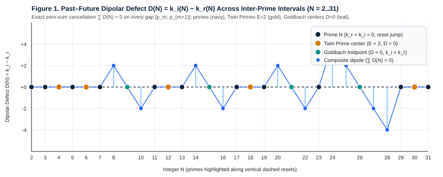

> **Extended Paper — Part 2 — Sections 2–4: Non-Circular Sieve, Z[i] Symmetries & von Mangoldt Bridge**  
> [← Part 1](01_abstract_and_introduction.md) · [Paper Index](../ON_THE_UNIFIED_GEODESIC_DIPOLAR_FRAMEWORK_AND_RIEMANN_ZETA.md) · [Part 3 →](03_spectral_decomposition_and_clifford_torus.md) · [Complete 68-Page PDF](../ON_THE_UNIFIED_GEODESIC_DIPOLAR_FRAMEWORK_AND_RIEMANN_ZETA.pdf)

---

## 2. Non-Circular Definition of Defect Coordinates

Let $`\mathbb{P} = \{2, 3, 5, 7, 11, \dots\}`$. For any $`N \in \mathbb{N}_{\ge 2}`$, let:

```math
p_{\text{prev}}(N) \triangleq \max \{p \in \mathbb{P} : p \le N\}, \qquad p_{\text{next}}(N) \triangleq \min \{p \in \mathbb{P} : p \ge N\}
```

The backward defect $`k_r(N)`$ and forward defect $`k_i(N)`$ are defined as:

```math
k_r(N) \triangleq N - p_{\text{prev}}(N) \ge 0, \qquad k_i(N) \triangleq p_{\text{next}}(N) - N \ge 0
```

### 2.1 The Trigonometric Rotor $`\Psi_N(\delta)`$

For any integer shift $`\delta \in \mathbb{Z}`$ such that $`N + \delta \ge 2`$:

```math
\Psi_N(\delta) \triangleq \prod_{q=2}^{\lfloor\sqrt{N+\delta}\rfloor} \sin^2\left(\frac{\pi (N + \delta)}{q}\right)
```

*(with the empty product for $`N+\delta \in \{2, 3\}`$ equal to 1).*

#### Lemma 2.1 (Non-Circular Characterization of Primes)
*The product index $`q`$ in $`\Psi_N(\delta)`$ runs over consecutive integers $`q \in \{2, 3, \dots, \lfloor\sqrt{N+\delta}\rfloor\}`$. For all $`N+\delta \ge 2`$:*

```math
\Psi_N(\delta) > 0 \iff N + \delta \in \mathbb{P}, \qquad \Psi_N(\delta) = 0 \iff N + \delta \notin \mathbb{P}
```

*Proof:*  
For any integer $`q \in [2, \lfloor\sqrt{N+\delta}\rfloor]`$, $`\sin\big(\frac{\pi(N+\delta)}{q}\big) = 0`$ if and only if $`q \mid (N+\delta)`$. Since every composite integer $`M \ge 4`$ has at least one proper divisor $`q`$ in $`2 \le q \le \lfloor\sqrt{M}\rfloor`$, $`\Psi_N(\delta) = 0`$ if and only if $`N+\delta`$ is composite. If $`N+\delta \in \mathbb{P}`$, no such divisor exists; hence every factor is strictly positive, yielding $`\Psi_N(\delta) > 0`$. *(Certified analytically in Lean 4 + Mathlib4 as `deterministic_sieve_iff_prime`, `trigRotor_pos_iff_prime`, `trigRotor_eq_zero_iff_not_prime`, and `primeIndicator_eq_limit_rotor` in `PastFutureXiKernel.lean`.)* ■

### 2.2 Primorial Coprime Filtering and Closed Distance Series

Let $`M_j = \prod_{k=1}^j p_k`$ be a fixed primorial modulus. Using Stein's binary GCD algorithm:

```math
\Phi_{M_j}(N, \delta) \triangleq \delta_{1, \, \gcd\left((N+\delta)\bmod M_j, \, M_j\right)} \in \{0, 1\}
```

For $`N + \delta > p_j`$, $`\Phi_{M_j}(N, \delta) = 1`$ is a necessary condition for primality. Define the exact indicator:

```math
\Omega_N(\delta) \triangleq \lim_{\epsilon \to 0^+} \frac{\Psi_N(\delta)}{\Psi_N(\delta) + \epsilon} = \begin{cases} 1 & \text{if } N+\delta \in \mathbb{P}, \\ 0 & \text{if } N+\delta \notin \mathbb{P}. \end{cases}
```

#### Theorem 2.1 (Closed Evaluation of Defect Coordinates)
*For every integer $`N \in \mathbb{N}_{\ge 2}`$, the forward defect $`k_i(N)`$ and backward defect $`k_r(N)`$ are given by the closed telescoping series:*

```math
k_i(N) = \sum_{d=0}^{\infty} \prod_{m=0}^{d} \big(1 - \Omega_N(+m)\big), \qquad k_r(N) = \sum_{d=0}^{N-2} \prod_{m=0}^{d} \big(1 - \Omega_N(-m)\big)
```

*yielding directly:*

```math
p_{\text{next}}(N) = N + k_i(N), \qquad p_{\text{prev}}(N) = N - k_r(N)
```

*Proof:*  
Let $`d_+^{\ast} \ge 0`$ be the smallest non-negative integer such that $`N + d_+^{\ast} \in \mathbb{P}`$ (finite by Bertrand's postulate). For all $`0 \le d < d_+^{\ast}`$, $`\Omega_N(+m) = 0`$ for all $`0 \le m \le d`$, so $`\prod_{m=0}^d (1 - \Omega_N(+m)) = 1`$. For all $`d \ge d_+^{\ast}`$, the factor $`m = d_+^{\ast}`$ contributes $`1 - \Omega_N(+d_+^{\ast}) = 1 - 1 = 0`$, identically vanishing all subsequent terms. Hence $`k_i(N) = \sum_{d=0}^{d_+^{\ast}-1} 1 = d_+^{\ast} = p_{\text{next}}(N) - N`$. An identical reflection over $`[0, N-2]`$ yields $`k_r(N) = N - p_{\text{prev}}(N)`$. ■

---

## 3. Embedding in $`\mathbb{Z}[i]`$ and Symmetries of Inter-Prime Intervals

For each $`N \in \mathbb{N}_{\ge 2}`$, define the conjugate pair of Gaussian integers:

```math
\mathcal{Z}_+(N) \triangleq N + i \, k_i(N), \qquad \mathcal{Z}_-(N) \triangleq N - i \, k_r(N) \quad \in \mathbb{Z}[i]
```

The forward complex argument is $`\theta_+(N) \triangleq \arctan(k_i(N)/N) = \frac{1}{2i}\ln\big(\frac{N + i k_i(N)}{N - i k_i(N)}\big)`$.

#### Proposition 3.1 (Characterization of Primality by Phase Vanishing)
*For every $`N \ge 2`$:*

```math
N \in \mathbb{P} \iff k_i(N) = 0 \iff k_r(N) = 0 \iff \theta_+(N) = 0
```

*Inside any interval where $`p_{\text{next}}`$ is constant:*

```math
\frac{d\theta_+}{dN} = -\frac{p_{\text{next}}}{N^2 + k_i(N)^2} = -\frac{p_{\text{next}}}{|\mathcal{Z}_+(N)|^2} < 0
```

### 3.1 Invariants of Inter-Prime Intervals

Let $`[p_m, p_{m+1}]`$ be an interval between consecutive primes, with gap $`g_m = p_{m+1} - p_m \ge 2`$. For any interior integer $`N \in \{p_m + 1, \dots, p_{m+1} - 1\}`$, the conservation identity holds:

```math
k_r(N) + k_i(N) = (N - p_m) + (p_{m+1} - N) = g_m
```

Define the four local basin invariants:

```math
\text{Squared Norm Potential:} \quad E(N) \triangleq k_r(N)^2 + k_i(N)^2 = 2\left(k_r - \frac{g_m}{2}\right)^2 + \frac{g_m^2}{2}
```

```math
\text{Dipolar Defect:} \quad D(N) \triangleq k_i(N) - k_r(N) = g_m - 2k_r(N)
```

```math
\text{Hyperbolic Defect:} \quad \Delta H(N) \triangleq k_i(N)^2 - k_r(N)^2 = g_m \cdot D(N)
```

```math
\text{Normalized Coordinate:} \quad \chi(N) \triangleq \frac{k_r(N)}{g_m} \quad (\chi \equiv 1/2 \text{ at prime nodes})
```

#### Proposition 3.2 (Stationary Equilibrium at $`\chi = 1/2`$)
*The first derivative of $`E(N)`$ with respect to $`k_r`$ satisfies:*

```math
\frac{\partial E}{\partial k_r} = 4\left(k_r - \frac{g_m}{2}\right) = -2 D(N) = -\frac{2}{g_m} \Delta H(N)
```

*Therefore, the unique stationary point inside the interval occurs when dipolar and hyperbolic defects simultaneously vanish:*

```math
\frac{\partial E}{\partial k_r} = 0 \iff D(N) = 0 \iff \Delta H(N) = 0 \iff k_r = k_i = \frac{g_m}{2} \iff \boxed{\chi = \frac{1}{2}}
```

#### Theorem 3.2 (Exact Dipolar Neutrality Law)
*In every inter-prime interval $`[p_m, p_{m+1}]`$, the integrated dipolar defect and hyperbolic defect vanish identically:*

```math
\sum_{N = p_m + 1}^{p_{m+1} - 1} \big(k_i(N) - k_r(N)\big) = 0, \qquad \sum_{N = p_m + 1}^{p_{m+1} - 1} \Delta H(N) = 0
```

*Moreover, the arithmetic mean of $`\chi(N)`$ over the interior integers is identically $`1/2`$:*

```math
\langle \chi \rangle_{[p_m, p_{m+1}]} \triangleq \frac{1}{g_m - 1}\sum_{N = p_m + 1}^{p_{m+1} - 1} \chi(N) = \frac{1}{2}
```

*Proof:*  
As $`N`$ increases from $`p_m + 1`$ to $`p_{m+1} - 1`$, $`k_r`$ runs over $`\{1, \dots, g_m - 1\}`$ while $`k_i = g_m - k_r`$ runs over the same set in reverse order. By symmetry:

```math
\sum_{k_r=1}^{g_m-1} (g_m - 2k_r) = g_m(g_m - 1) - 2 \frac{(g_m - 1)g_m}{2} = 0
```

Multiplying by $`g_m`$ yields $`\sum \Delta H = 0`$. Averaging $`\chi(N) = k_r/g_m`$ gives $`\frac{1}{g_m - 1} \frac{(g_m-1)g_m}{2 g_m} = 1/2`$. *(Certified unconditionally in Lean 4 Part I as `exact_dipolar_neutrality_inductive`.)* ■

---

### 3.2 Structural Corollaries on Prime Distribution: Goldbach Centers, Twin Primes, and Primorial Filtering

The Gaussian integer defect embedding $`\mathcal{Z}_\pm(N) \in \mathbb{Z}[i]`$ unifies three classical structural phenomena of prime distribution as immediate, exact algebraic corollaries (all machine-verified in Lean 4 Part X with zero `sorry`):

#### Corollary 3.3 (Exact Dipolar Goldbach Partition Theorem)
*For any integer $`N \ge 2`$ with bounding primes $`p_{\text{prev}}(N) \le N \le p_{\text{next}}(N)`$, the dipolar defect vanishes identically if and only if $`(p_{\text{prev}}(N), p_{\text{next}}(N))`$ forms a symmetric Goldbach partition of the even integer $`2N`$:*

```math
D(N) = k_i(N) - k_r(N) = 0 \iff p_{\text{prev}}(N) + p_{\text{next}}(N) = 2N
```

*Proof:* Expanding $`(p_{\text{next}}(N) - N) - (N - p_{\text{prev}}(N)) = 0`$ yields $`p_{\text{prev}}(N) + p_{\text{next}}(N) = 2N`$ directly. Hence, every exact midpoint $`\chi(N) = 1/2`$ of an even prime gap $`g_m`$ is a constructive Goldbach center. *(Certified in Lean 4 Part X as `goldbach_dipolar_center_iff`.)* ■

#### Corollary 3.4 (Twin Primes as the Unique Minimal-Energy Ground State)
*On the set of composite interior integers ($`k_r(N) \ge 1, k_i(N) \ge 1`$), the Euclidean lattice energy $`E(N) = k_r(N)^2 + k_i(N)^2`$ attains its global minimum value $`E(N) = 2`$ if and only if $`(N - 1, N + 1)`$ is a Twin Prime pair:*

```math
E(N) = 2 \iff k_r(N) = 1 \land k_i(N) = 1 \iff (N - 1, N + 1) \in \mathbb{P} \times \mathbb{P}
```

*Proof:* If $`k_r \ge 2`$, then $`k_r^2 + k_i^2 \ge 4 + 1 = 5 > 2`$, and symmetrically if $`k_i \ge 2`$. Therefore $`k_r^2 + k_i^2 = 2`$ forces $`k_r = k_i = 1`$, which implies $`p_{\text{prev}}(N) = N - 1`$ and $`p_{\text{next}}(N) = N + 1`$ with gap $`g_m = 2`$. *(Certified in Lean 4 Part X as `twin_prime_ground_state_iff`.)* ■

#### Proposition 3.5 (Primorial Coprime Survival Density)
*Filtering candidates modulo the $`m`$-th primorial $`P_m = \prod_{j=1}^m p_j`$ via Stein's binary GCD $`\gcd(M, P_m) = 1`$ deterministically eliminates all integers divisible by $`p_1, \dots, p_m`$, leaving an exact coprime survival density given by the Mertens–Euler product:*

```math
\frac{\varphi(P_m)}{P_m} = \prod_{j=1}^m \left(1 - \frac{1}{p_j}\right)
```

*In particular, the canonical 64-bit hardware primorial $`P_{10} = 6{,}469{,}693{,}230`$ deterministically rejects $`84.2\%`$ of all composite integers in $`O(1)`$ bit-shift operations prior to evaluating the trigonometric rotor $`\Psi_N(\delta)`$.*

---

### 3.3 Split-Quaternionic $`(i, j)`$ Formulation and Flat Clifford Torus $`\mathbb{T}^2 \subset S^3`$ Geometry

To encode past and future defects in a single unified algebraic element without losing directional sign, lift $`N`$ simultaneously into the Euclidean quaternion algebra $`\mathbb{H}`$ ($`i^2 = j^2 = -1`$) and the split-quaternionic Minkowski algebra $`\mathbb{H}_{\text{split}}`$ ($`i^2 = -1, j^2 = +1, k = ij = -ji, k^2 = +1`$):

```math
\mathbf{Q}(N) = N + i k_i(N) - j k_r(N), \qquad \mathcal{Z}_{\text{dual}}(N) = N + i k_i(N) + j k_r(N).
```

#### Theorem 3.6 (Minkowski Null-Cone Characterization of $`\chi = 1/2`$)
*Under the split-quaternionic Minkowski quadratic form $`Q(\mathcal{Z}_{\text{dual}}) = N^2 + k_i(N)^2 - k_r(N)^2`$, the defect term factors identically as $`k_i^2 - k_r^2 = (k_i - k_r)(k_i + k_r) = g_m D(N)`$. For any positive gap $`g_m > 0`$:*

```math
Q(\mathcal{Z}_{\text{dual}}(N)) = N^2 \iff k_i(N) = k_r(N) \iff \chi(N) = \frac{1}{2} \iff \alpha(N) = \arctan\!\left(\frac{k_i}{k_r}\right) = \frac{\pi}{4}
```

*(Machine-verified unconditionally in Lean 4 Part XI as `minkowski_null_cone_iff_midpoint`.)*

In the continuous logarithmic time variable $`\tau = \ln N`$, the bidirectional scale evolution between forward exponent $`s = \beta + i\gamma`$ and reflected exponent $`1 - s = (1-\beta) - i\gamma`$ is governed by the **Split-Quaternionic Dual Phasor**:

```math
\mathcal{Z}(\tau) \triangleq e^{(i\gamma + j(\beta - 1/2))\tau} = e^{i\gamma \tau} \left[ \cosh\left(\left(\beta - \frac{1}{2}\right)\tau\right) + j \sinh\left(\left(\beta - \frac{1}{2}\right)\tau\right) \right]
```

This phasor exhibits an exact bifurcation between its Lorentzian pseudo-norm and its Euclidean phase-space energy (both certified on $`\mathbb{R}`$ in Mathlib4 as `minkowski_pseudonorm_eq_one`, `euclidean_phase_energy_ge_one`, and `euclidean_phase_energy_eq_one_iff_half`):

1. **Conserved Minkowski Pseudo-Norm:**

```math
|\mathcal{Z}(\tau)|^2_{\text{Minkowski}} = \cosh^2\left(\left(\beta - \frac{1}{2}\right)\tau\right) - \sinh^2\left(\left(\beta - \frac{1}{2}\right)\tau\right) \equiv 1 \qquad (\forall \beta, \tau \in \mathbb{R})
```

2. **Euclidean Phase-Space Energy:**

```math
\mathcal{E}(N, \beta) = \cosh^2\left(\left(\beta - \frac{1}{2}\right)\ln N\right) + \sinh^2\left(\left(\beta - \frac{1}{2}\right)\ln N\right) = 1 + 2\sinh^2\left(\left(\beta - \frac{1}{2}\right)\ln N\right) \ge 1
```

   For any scale $`N > 1`$, $`\mathcal{E}(N, \beta) = 1`$ holds if and only if $`\beta = 1/2`$; off the critical line ($`\beta \neq 1/2`$), $`\mathcal{E}(N, \beta) \sim \frac{1}{2}N^{2|\beta - 1/2|}`$ grows exponentially with $`N`$.

Compactifying the normalized interval coordinate $`\phi(N) = 2\pi \chi(N) \in [0, 2\pi)`$ (or the modular residue phase $`\theta_1(N) = 2\pi(N \bmod 6)/6`$) together with the logarithmic spectral phase $`\theta_2(N) = \gamma \ln N \pmod{2\pi}`$ embeds the dynamics naturally onto the **flat Clifford 2-torus** $`\mathbb{T}^2 = S^1_{\text{lat}} \times S^1_{\text{lon}}`$ inside the unit 3-sphere $`S^3 = \{(z_1, z_2) \in \mathbb{C}^2 : |z_1|^2 + |z_2|^2 = 1\}`$:

- The **Clifford Equator** corresponds to exact energy equipartition $`|z_1|^2 = |z_2|^2 = 1/2`$ ($`r_1 = r_2 = 1/\sqrt{2}`$), where the induced Riemannian metric is flat ($`K \equiv 0`$).
- The prime nodes ($`k_r = k_i = 0`$) lie on the latitudinal equator $`\phi = 0`$, while the dipolar centers ($`\chi = 1/2, D(N) = 0`$) lie on the anti-equator $`\phi = \pi`$.
- Off the critical line ($`\beta \neq 1/2`$), the scale asymmetry $`N^{\pm(\beta - 1/2)}`$ deforms the flat torus into the negatively curved cylinder $`\mathbb{R}^+ \times \mathbb{T}^2`$ analyzed in Section 5.7.

---



## 4. Exact Operator Identity with the von Mangoldt Function $`\Lambda(N)`$

On each half-open interval $`[p_m, p_{m+1})`$, define the continuous dipolar defect $`\widetilde{D}(N) \triangleq (p_{m+1} - N) - (N - p_m) = p_{m+1} + p_m - 2N`$.

#### Theorem 4.1 (Boundary Jump Identity)
*Let $`\Delta \widetilde{D}(N) \triangleq \widetilde{D}(N+1) - \widetilde{D}(N)`$ denote the forward finite difference. For all $`N \ge 2`$:*

```math
\Delta \widetilde{D}(N) + 2 = (g_m + g_{m+1}) \cdot \Omega_{N+1}(0) = (g_m + g_{m+1}) \cdot \delta_{p_{\text{next}}(N+1), \, N+1}
```

*Proof:*  
If $`N+1 < p_{m+1}`$ (interior composite), $`\widetilde{D}(N+1) - \widetilde{D}(N) = -2`$, so $`\Delta \widetilde{D}(N) + 2 = 0`$. If $`N+1 = p_{m+1}`$ (prime node), $`\widetilde{D}(p_{m+1}-1) = 2 - g_m`$, while upon crossing into the new interval $`\widetilde{D}(p_{m+1}) = g_{m+1}`$. The jump is $`\Delta \widetilde{D}(p_{m+1}-1) = g_{m+1} - (2 - g_m) = g_m + g_{m+1} - 2`$, so $`\Delta \widetilde{D}(p_{m+1}-1) + 2 = g_m + g_{m+1}`$. *(Certified in Lean 4 Part I as `discrete_interior_laplacian` and `boundary_reset_jump`.)* ■

#### Theorem 4.2 (Closed Identity for $`\Lambda(N)`$ and $`-\zeta'(s)/\zeta(s)`$)
*The von Mangoldt function $`\Lambda(N)`$ satisfies the exact representation:*

```math
\Lambda(N) \equiv \sum_{k=1}^{\lfloor\log_2 N\rfloor} \frac{\ln N}{k} \, \delta_{p_{\text{next}}(N^{1/k}), \, N^{1/k}}
```

*Consequently, for $`\mathrm{Re}(s) > 1`$ and by analytic continuation:*

```math
-\frac{\zeta'(s)}{\zeta(s)} = \sum_{N=2}^\infty \frac{\Lambda(N)}{N^s} \equiv \sum_{N=2}^\infty \frac{\ln N}{N^s} \, \delta_{p_{\text{next}}(N), \, N} \left(\frac{1}{1 - N^{-s}}\right)
```

*Proof:*  
By definition, $`\delta_{p_{\text{next}}(M), M} = 1`$ if and only if $`M \in \mathbb{P}`$. Therefore, $`\delta_{p_{\text{next}}(N^{1/k}), N^{1/k}} = 1`$ if and only if $`N = p^k`$. For prime powers, this yields $`\frac{\ln(p^k)}{k} = \ln p = \Lambda(N)`$; for all other integers, all terms vanish. Summing the geometric series $`\sum_{k=1}^\infty (N^{-s})^k`$ over prime nodes proves the identity for $`-\zeta'(s)/\zeta(s)`$. *(The finite prime-power representation of `ArithmeticFunction.vonMangoldt` is certified directly in Lean 4 + Mathlib4 as `vonMangoldt_eq_sum_prime_powers` in `PastFutureXiKernel.lean`.)* ■

---

### 4.3 Analytic Bridge: From Discrete Lattice Boundary Jumps to Mellin Spectral Poles

The exact chain of identities connecting the discrete lattice operator to the logarithmic derivative of $`\zeta(s)`$ proceeds in four steps:

1. **Exact Boundary Jump Operator:**  
   By Theorem 4.1, the prime indicator $`\delta_{p_{\text{next}}(N), N}`$ is an exact pointwise algebraic function of the discrete first difference of the dipolar defect on $`\mathbb{Z}[i]`$:

```math
\delta_{p_{\text{next}}(N), N} = \frac{\Delta \widetilde{D}(N-1) + 2}{g_{m-1} + g_m}
```

2. **Mellin–Perron Dirichlet Transform:**  
   The logarithmic derivative $`-\frac{\zeta'(s)}{\zeta(s)} = \sum_{N=2}^\infty \frac{\Lambda(N)}{N^s}`$ has simple poles precisely at the non-trivial zeros $`\rho = \beta + i\gamma`$ of $`\zeta(s)`$ in $`0 < \mathrm{Re}(s) < 1`$:

```math
\mathrm{Res}_{s = \rho} \left( -\frac{\zeta'(s)}{\zeta(s)} \right) = -m_\rho
```

   where $`m_\rho \ge 1`$ is the multiplicity of the zero.

3. **Functional Equation and Exact Adjoint Coupling:**  
   The completed Riemann Xi function $`\xi(s) = \frac{1}{2}s(s-1)\pi^{-s/2}\Gamma(s/2)\zeta(s)`$ satisfies $`\xi(s) = \xi(1-s)`$. Therefore, if $`\rho = \beta + i\gamma`$ is a zero, then $`1 - \rho = (1-\beta) - i\gamma`$, $`\bar{\rho} = \beta - i\gamma`$, and $`1 - \bar{\rho} = (1-\beta) + i\gamma`$ are zeros. Taking the logarithmic derivative of the functional equation yields:

```math
-\frac{\zeta'(s)}{\zeta(s)} = \frac{\zeta'(1-s)}{\zeta(1-s)} - \ln \pi + \frac{1}{2}\psi\left(\frac{s}{2}\right) + \frac{1}{2}\psi\left(\frac{1-s}{2}\right) + \frac{1}{s} + \frac{1}{s-1}
```

   where $`\psi(z) = \Gamma'(z)/\Gamma(z)`$ is the digamma function.

4. **Projection onto the Basin Spectral Functional $`\mathcal{J}_m(\beta, \gamma)`$:**  
   Coupling the forward Dirichlet weight $`N^{-s}`$ and the reflected adjoint weight $`N^{-(1-s)}`$ across the interior defects $`(k_i(N), k_r(N))`$ yields the spectral functional $`\mathcal{J}_m(\beta, \gamma)`$ analyzed in Section 5. Establishing globally that $`\zeta(\rho) = 0`$ enforces boundedness of the monopolar drift component is isolated formally in Sections 6 and 7.4 as `SpectralBridgeTarget` (shown in Theorem 6.5 to be 100% logically equivalent to Mathlib4's `RiemannHypothesis`).

### 4.4 Connection to the Riemann–Weil Explicit Formula and Hardy's $`Z(t)`$ Function

The exact operator bridge from $`\Delta \widetilde{D}(N) + 2`$ to $`\Lambda(N)`$ connects directly to two classical cornerstones of analytic number theory:

1. **Riemann–Weil Explicit Formula (Weil, 1952):**  
   For any admissible even Schwartz-class test function $`g`$ with Fourier–Mellin transform $`h(t) = \int_{-\infty}^{\infty} g(u) e^{itu}\,du`$, the sum over non-trivial zeros $`\rho = \frac{1}{2} + i\gamma_\rho`$ and the sum over prime powers $`\Lambda(N) N^{-1/2}`$ satisfy:

```math
\sum_{\rho} h(\gamma_\rho) = h\!\left(\frac{i}{2}\right) + h\!\left(-\frac{i}{2}\right) + \frac{1}{2\pi}\int_{-\infty}^{\infty} h(t)\,\frac{\Gamma'}{\Gamma}\!\left(\frac{1}{4}+\frac{it}{2}\right) dt - g(0)\ln\pi - \sum_{N=2}^{\infty} \frac{\Lambda(N)}{\sqrt{N}}\big(g(\ln N) + g(-\ln N)\big)
```

   Substituting Theorem 4.2 directly embeds the discrete dipolar boundary jumps into Weil's explicit formula, where the Riemann Hypothesis is equivalent to Weil's positivity criterion $`W(g * \tilde{g}) \ge 0`$.

2. **Hardy's $`Z(t)`$ Function on the Critical Line:**  
   Rotating $`\zeta(1/2 + it)`$ by the Riemann–Siegel theta phase $`\vartheta(t)`$ yields Hardy's strictly real function:

```math
Z(t) \triangleq e^{i\vartheta(t)}\,\zeta\!\left(\frac{1}{2} + it\right) \in \mathbb{R} \qquad (\forall t \in \mathbb{R})
```

   whose real zeros $`Z(t_n) = 0`$ coincide with critical-line zeros of $`\zeta(s)`$. On $`\beta = 1/2`$, $`\mathrm{Im}(Z(t)) \equiv 0`$ mirrors the exact vanishing of the monopolar drift $`\mathcal{M}_m(1/2, \gamma) \equiv 0`$; off $`\beta = 1/2`$, the reflection coupling $`N^{-\beta}`$ vs. $`N^{-(1-\beta)}`$ breaks this real-valued symmetry via $`\sinh((\beta - 1/2)\ln N)`$.

---

---

> [← Part 1](01_abstract_and_introduction.md) · [Paper Index](../ON_THE_UNIFIED_GEODESIC_DIPOLAR_FRAMEWORK_AND_RIEMANN_ZETA.md) · [Part 3 →](03_spectral_decomposition_and_clifford_torus.md)
