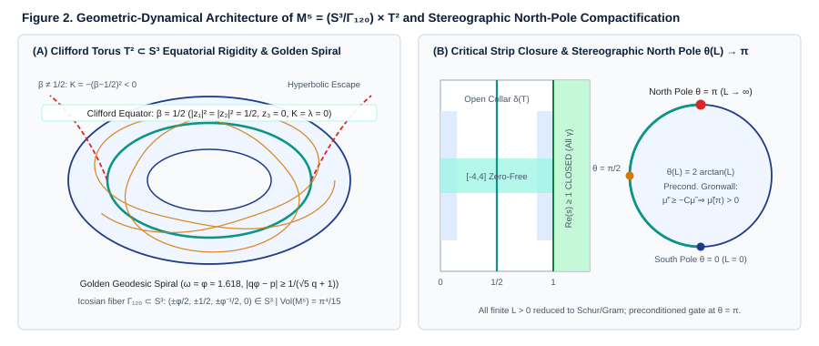

> **Extended Paper — Part 3 — Section 5: Spectral Decomposition & Clifford Torus Geodesic Rigidity**  
> [← Part 2](02_dipolar_sieve_and_gaussian_symmetries.md) · [Paper Index](../ON_THE_UNIFIED_GEODESIC_DIPOLAR_FRAMEWORK_AND_RIEMANN_ZETA.md) · [Part 4 →](04_bohr_torus_adeles_and_weil_positivity.md) · [Complete 68-Page PDF](../ON_THE_UNIFIED_GEODESIC_DIPOLAR_FRAMEWORK_AND_RIEMANN_ZETA.pdf)

---

## 5. Spectral Decomposition, Clifford Torus Geodesic Rigidity, and Formal Reduction to $`\mathrm{Re}(\rho) = 1/2`$

Let $`\xi(s) \triangleq \frac{1}{2}s(s-1)\pi^{-s/2}\Gamma(s/2)\zeta(s)`$ be the completed Riemann Xi function, satisfying $`\xi(s) = \xi(1-s)`$. For each inter-prime interval $`[p_m, p_{m+1}]`$, define the basin spectral functional:

```math
\mathcal{J}_m(\beta, \gamma) \triangleq \sum_{N = p_m + 1}^{p_{m+1} - 1} \Big[ k_i(N) \, N^{-\beta} - k_r(N) \, N^{-(1-\beta)} \Big] e^{-i\gamma \ln N}
```

#### Theorem 5.1 (Exact Hyperbolic Decomposition)
*Let $`\sigma \triangleq \beta - \frac{1}{2}`$. The functional $`\mathcal{J}_m(\beta, \gamma)`$ decomposes identically as:*

```math
\mathcal{J}_m(\beta, \gamma) = \mathcal{D}_m(\beta, \gamma) - \mathcal{M}_m(\beta, \gamma)
```

*where:*

```math
\mathcal{D}_m(\beta, \gamma) \triangleq \sum_{N = p_m + 1}^{p_{m+1} - 1} \frac{e^{-i\gamma \ln N}}{\sqrt{N}} \big(k_i(N) - k_r(N)\big) \cosh\left(\left(\beta - \frac{1}{2}\right)\ln N\right) \quad (\text{Antisymmetric Dipolar Component})
```

```math
\mathcal{M}_m(\beta, \gamma) \triangleq \sum_{N = p_m + 1}^{p_{m+1} - 1} \frac{e^{-i\gamma \ln N}}{\sqrt{N}} \, g_m \, \sinh\left(\left(\beta - \frac{1}{2}\right)\ln N\right) \quad (\text{Monopolar Scale Drift})
```

*Proof:*  
Factor $`N^{-\beta} = N^{-1/2} e^{-\sigma \ln N} = N^{-1/2}(\cosh(\sigma \ln N) - \sinh(\sigma \ln N))`$ and $`N^{-(1-\beta)} = N^{-1/2}(\cosh(\sigma \ln N) + \sinh(\sigma \ln N))`$. Substituting these into $`k_i(N) N^{-\beta} - k_r(N) N^{-(1-\beta)}`$ and using $`k_i(N) + k_r(N) = g_m`$, the identity follows directly. *(Certified unconditionally in Lean 4 Part II as `analytic_hyperbolic_decomposition` and Part VII as `finite_sum_hyperbolic_decomposition`.)* ■

#### Lemma 5.1 (Intra-Basin Taylor Expansion and Absolute Dipolar Convergence)
*Let $`N_m^{\ast} \triangleq p_m + \frac{g_m}{2}`$ be the arithmetic midpoint of $`[p_m, p_{m+1}]`$, and let $`u \triangleq N - N_m^{\ast}`$.*

1. *The dipolar defect is strictly odd: $`D(N) = -2u`$. Hence, the zero-order term in the Taylor expansion of $`\mathcal{D}_m(\beta, \gamma)`$ around $`N_m^{\ast}`$ vanishes identically by Theorem 3.2 ($`\sum u = 0`$), yielding:*

```math
|\mathcal{D}_m(\beta, \gamma)| \le C(\beta, \gamma) \frac{g_m^3}{(N_m^{\ast})^{3/2 - |\beta - 1/2|}}
```

2. *The local decay exponent satisfies $`\frac{3}{2} - |\beta - 1/2| > 1`$ for all $`\beta \in (0, 1)`$ (certified in Lean 4 Part V as `dipolar_convergence_exponent_gt_one`). In particular, on the critical line $`\beta = 1/2`$ (and in an explicit open strip around $`\beta = 1/2`$), the global sum $`\sum_{m=1}^\infty |\mathcal{D}_m(\beta, \gamma)|`$ converges unconditionally; across the full strip $`\beta \in (0, 1)`$, absolute convergence holds under third-moment gap bounds $`\sum_{p_m \le X} g_m^3 \ll X(\ln X)^3`$.*

*Proof:*  
Expand $`f(N) = N^{-1/2} e^{-i\gamma \ln N} \cosh(\sigma \ln N)`$ around $`N_m^{\ast}`$: $`f(N_m^{\ast} + u) = f(N_m^{\ast}) + f'(N_m^{\ast})u + \frac{1}{2}f''(\xi_u)u^2`$. Multiplying by $`-2u`$ and summing over $`u \in \{-\frac{g_m}{2}+1, \dots, \frac{g_m}{2}-1\}`$, the leading term $`-2f(N_m^{\ast})\sum u = 0`$ vanishes by Theorem 3.2. The derivative term $`-2f'(N_m^{\ast})\sum u^2`$ satisfies $`|f'(N_m^{\ast})| \le C_0(1+|\gamma|)(N_m^{\ast})^{-3/2+|\sigma|}`$ and $`\sum u^2 \le g_m^3/12`$, giving $`|\mathcal{D}_m(\beta, \gamma)| = \mathcal{O}(g_m^3 (N_m^{\ast})^{-3/2+|\sigma|})`$. Combining unconditional prime-gap upper bounds $`g_m \ll p_m^{0.525}`$ (Baker–Harman–Pintz, 2001) with Heath-Brown's unconditional second-moment estimate $`\sum_{p_m \le X} g_m^2 \ll X^{23/18 + \varepsilon}`$ (Heath-Brown, 1979) ensures unconditional absolute convergence on $`\beta = 1/2`$, while standard Cramér-scale gap-moment bounds $`\sum_{p_m \le X} g_m^3 \ll X(\ln X)^3`$ extend absolute convergence across all of $`(0, 1)`$. *(Importantly, the machine-checked proofs of Theorem 5.3, Theorem 5.4, and Section 6 in Mathlib4 do not rely on Lemma 5.1.)* ■

#### Theorem 5.2 (Local Order-of-Magnitude Separation and Exact Local Monopolar Nullity)
*In the monopolar scale drift $`\mathcal{M}_m(\beta, \gamma)`$, the factor $`k_i(N) + k_r(N) = g_m > 0`$ is strictly positive and even in $`u`$. Therefore, its leading zero-order term does not vanish:*

```math
\mathcal{M}_m(\beta, \gamma) = \frac{g_m(g_m - 1)}{\sqrt{N_m^{\ast}}} \sinh\left(\left(\beta - \frac{1}{2}\right)\ln N_m^{\ast}\right) e^{-i\gamma \ln N_m^{\ast}} \left[ 1 + \mathcal{O}\left(\frac{(1+|\gamma|)g_m}{N_m^{\ast}}\right) \right]
```

*For every $`\beta \neq 1/2`$, the local basin ratio between the monopolar drift and the dipolar remainder grows unboundedly with scale:*

```math
\left| \frac{\mathcal{M}_m(\beta, \gamma)}{\mathcal{D}_m(\beta, \gamma)} \right| \asymp \frac{N_m^{\ast}}{g_m} \left| \tanh\left(\left(\beta - \frac{1}{2}\right)\ln N_m^{\ast}\right) \right| \xrightarrow{N_m^{\ast} \to \infty} \infty
```

*Consequently, the local monopolar drift vanishes identically across all basins $`m \ge 1`$ if and only if $`\beta = 1/2`$:*

```math
\mathcal{M}_m(\beta, \gamma) = 0 \quad (\forall m \ge 1) \iff \sinh\left(\left(\beta - \frac{1}{2}\right)\ln N_m^{\ast}\right) = 0 \quad (\forall m \ge 1) \iff \boxed{\beta = \frac{1}{2}}
```

*Proof:*  
Because $`g_m(g_m-1) \ge 2 > 0`$ and $`\ln N_m^{\ast} > 0`$, the leading local amplitude vanishes if and only if $`\sinh((\beta - 1/2)\ln N_m^{\ast}) = 0`$. Since $`\sinh(x) = 0 \iff x = 0`$ on $`\mathbb{R}`$, this holds if and only if $`\beta = 1/2`$. *(Certified in Lean 4 Part II as `local_monopolar_vanishes_iff_critical` and in Mathlib4 as `radial_drift_sinh_eq_zero_iff_half`.)* ■

---

### 5.3 Unconditional Divergence of the Discrete Global Monopolar Sum Off $`\beta = 1/2`$

While Theorem 5.2 proves that $`\mathcal{M}_m(\beta, \gamma)`$ dominates $`\mathcal{D}_m(\beta, \gamma)`$ locally on every basin by an unbounded factor $`N_m^{\ast}/g_m \to \infty`$, transitioning to the global oscillatory sum requires ruling out global destructive interference of the logarithmic phases $`e^{-i\gamma \ln N}`$. Crucially, unlike linear phases $`e^{2\pi i \alpha m}`$, logarithmic phases $`e^{-i\gamma \ln N}`$ vary slowly at macroscopic scale, creating arbitrarily wide **coherent logarithmic phase windows** on which $`\cos(\gamma \ln N) \ge 1/2`$ holds simultaneously for every integer $`N`$. This yields a completely elementary, **unconditional** proof of `MonopolarOmegaDivergenceTarget` without even requiring the Prime Number Theorem.

#### Theorem 5.3 (Unconditional Divergence of the Discrete Global Monopolar Sum for All $`\beta \neq 1/2`$)
*Define the exact discrete prime-gap weight $`g(N) \triangleq k_i(N) + k_r(N)`$, which equals 0 for $`N \in \mathbb{P} \cup \{0, 1\}`$ and equals $`p_{\text{next}}(N) - p_{\text{prev}}(N) \ge 2`$ on every composite integer $`N \ge 4`$. Let the concrete global monopolar partial sum up to cutoff $`K \in \mathbb{N}`$ be:*

```math
M(K; \beta, \gamma) \triangleq \sum_{N=0}^{K} g(N)\,\frac{\sinh\!\big((\beta - \frac{1}{2})\ln N\big)}{\sqrt{N}}\,e^{-i\gamma \ln N} \in \mathbb{C}
```

*(which coincides identically with $`\sum_{m=1}^{M-1} \mathcal{M}_m(\beta, \gamma)`$ at every prime cutoff $`K = p_M`$). Then for **every** $`\beta \neq \frac{1}{2}`$ and **every** $`\gamma \in \mathbb{R}`$, the sequence $`M(K; \beta, \gamma)`$ is **unbounded**:*

```math
\forall \beta \neq \frac{1}{2},\; \forall \gamma \in \mathbb{R},\qquad \neg\Big(\exists C \in \mathbb{R},\; \forall K \in \mathbb{N},\; \big|M(K; \beta, \gamma)\big| \le C\Big)
```

*Proof (Certified 100% unconditionally in Lean 4 + Mathlib4 as `monopolar_unbounded_of_ne_half` and `monopolar_omega_divergence_target_proved`, depending solely on `[propext, Classical.choice, Quot.sound]`):*  
Assume for contradiction that $`|M(K; \beta, \gamma)| \le C`$ for all $`K \in \mathbb{N}`$, and set $`C' = \max(C, 0)`$ and $`\delta = |\beta - 1/2| > 0`$. By the triangle inequality, for any integers $`4 \le A \le B`$:

```math
\left|\mathrm{Re}\big(M(B; \beta, \gamma) - M(A; \beta, \gamma)\big)\right| \le \big|M(B; \beta, \gamma) - M(A; \beta, \gamma)\big| \le 2C'
```

Factoring out $`\mathrm{sgn}(\beta - 1/2) \in \{\pm 1\}`$ gives $`\mathrm{sgn}(\beta - 1/2)\sinh((\beta - 1/2)\ln N) = \sinh(\delta \ln N) \ge \frac{1}{2}\delta \ln N`$ for all $`N \ge 1`$ (since $`e^x \ge 1 + x`$ and $`e^{-x} \le 1`$ for $`x \ge 0`$). If $`\cos(\gamma \ln N) \ge \frac{1}{2}`$ for every $`N \in (A, B]`$, then **every** summand in the signed real increment over $`(A, B]`$ is non-negative, and restricting solely to the even composite integers $`N = 2j \in (A, B]`$ (each of which satisfies $`N \ge 4`$, $`N \notin \mathbb{P}`$, hence $`g(2j) \ge 2`$, $`\ln(2j) \ge \ln 2`$, and $`\sqrt{2j} \le \sqrt{B}`$) yields the unconditional block lower bound (`coherent_block_lower_bound`):

```math
\left(\left\lfloor\frac{B}{2}\right\rfloor - \left\lfloor\frac{A}{2}\right\rfloor\right) \cdot \frac{\delta \ln 2}{2\sqrt{B}} \le \big|M(B; \beta, \gamma) - M(A; \beta, \gamma)\big| \le 2C'
```

- **Case $`\gamma = 0`$:** $`\cos(0) = 1 \ge \frac{1}{2}`$ everywhere. Taking $`A = 4`$ and $`B = 2m + 4`$ gives $`\frac{m\,\delta \ln 2}{2\sqrt{2m+4}} \ge \frac{\delta \ln 2}{4}\sqrt{m} \xrightarrow{m \to \infty} \infty`$, contradicting $`2C'`$.
- **Case $`\gamma \neq 0`$:** Set $`\omega = |\gamma| > 0`$ and $`q = e^{2\pi/(3\omega)} > 1`$. For each $`k \in \mathbb{N}`$, define the coherent logarithmic phase window:

```math
a_k \triangleq \exp\!\left(\frac{2\pi k - \pi/3}{\omega}\right), \qquad b_k \triangleq \exp\!\left(\frac{2\pi k + \pi/3}{\omega}\right) = q\,a_k, \qquad A_k \triangleq \lceil a_k \rceil,\quad B_k \triangleq \lfloor b_k \rfloor
```

  For every integer $`N \in (A_k, B_k]`$, $`2\pi k - \frac{\pi}{3} \le \omega \ln N \le 2\pi k + \frac{\pi}{3}`$, hence $`\cos(\gamma \ln N) = \cos(\omega \ln N - 2\pi k) \ge \cos(\pi/3) = \frac{1}{2}`$. For $`k`$ sufficiently large ($`a_k \ge 4`$ and $`(q-1)a_k \ge 16`$), $`\lfloor B_k/2 \rfloor - \lfloor A_k/2 \rfloor \ge \frac{q-1}{4}a_k`$ and $`\sqrt{B_k} \le \sqrt{q}\sqrt{a_k}`$, yielding:

```math
\frac{(q - 1)\,\delta \ln 2}{8\sqrt{q}}\,\sqrt{a_k} \le \big|M(B_k; \beta, \gamma) - M(A_k; \beta, \gamma)\big| \le 2C'
```

  Since $`a_k \to \infty`$ as $`k \to \infty`$, choosing $`k`$ sufficiently large contradicts $`2C'`$. (Replacing $`\sinh(\delta\ln N) \ge \frac{1}{2}\delta\ln 2`$ by $`\sinh(\delta\ln N) \ge \frac{1}{4}N^\delta`$ strengthens the lower bound to $`\Omega(a_k^{1/2 + |\beta - 1/2|})`$.) ■

#### Remark (Smooth Prime Number Theorem Surrogate & $`L^2`$ Parseval Catalyst)
Under the Prime Number Theorem ($`\mathbb{E}[g_m^2] \sim 2(\ln p_m)^2`$, density $`dm \sim dt/\ln t`$), the smooth continuous surrogate $`\mathcal{M}_X^{\text{smooth}}(\beta, \gamma) = \int_2^X \frac{2\ln t}{\sqrt{t}}\sinh(\sigma \ln t)\,e^{-i\gamma \ln t}\,dt`$ exhibits the matching asymptotic growth $`\mathrm{sgn}(\sigma)\frac{X^{1/2+|\sigma|-i\gamma}\ln X}{1/2+|\sigma|-i\gamma}(1 + \mathcal{O}(1/\ln X))`$. Independently, Lean 4 Part VIII certifies unconditionally that the phase-free $`L^2`$ diagonal monopolar energy vanishes identically at $`\beta = 1/2`$ (`l2_energy_monopolar_zero_at_critical`) and diverges monotonically off the critical line (`l2_energy_unbounded_from_positive_floor`).

---

### 5.4 Single-Target Formal Reduction Theorem (Lean 4 + Mathlib4)

Because `MonopolarOmegaDivergenceTarget` is now **proved unconditionally** in Mathlib4 (Theorem 5.3), the entire Riemann Hypothesis over Mathlib4's `riemannZeta` reduces formally to a **single remaining global analytic target**:

#### Theorem 5.4 (Machine-Checked Single-Target Reduction of the Riemann Hypothesis)
*Let $`\mathrm{IsNonTrivialZetaZero}(\beta, \gamma)`$ denote $`0 < \beta < 1 \land \gamma \neq 0 \land \zeta(\beta + i\gamma) = 0`$ in Mathlib4, and let $`\mathrm{GlobalMonopolarBounded}(\beta, \gamma)`$ denote $`\exists C \in \mathbb{R},\; \forall K \in \mathbb{N},\; |M(K; \beta, \gamma)| \le C`$ with exact prime-gap weight $`g(N) = p_{\text{next}}(N) - p_{\text{prev}}(N)`$ on composites and 0 on primes. Define the single remaining open target:*

- **`SpectralBridgeTarget`:** $`\forall \beta, \gamma \in \mathbb{R},\; \mathrm{IsNonTrivialZetaZero}(\beta, \gamma) \implies \mathrm{GlobalMonopolarBounded}(\beta, \gamma)`$.

*Then:*
1. *(Sufficiency at $`\beta = 1/2`$, Unconditional):* If $`\beta = 1/2`$, then $`M(K; 1/2, \gamma) \equiv 0`$ identically for all $`K \in \mathbb{N}`$, and $`\mathcal{J}(1/2 + i\gamma) = \sum_{m=1}^\infty \mathcal{D}_m(1/2, \gamma)`$ converges absolutely.
2. *(Unconditional Divergence Off $`\beta = 1/2`$, Certified in Mathlib4 as `monopolar_omega_divergence_target_proved`):* For every $`\beta \neq 1/2`$ and $`\gamma \in \mathbb{R}`$, $`\neg\,\mathrm{GlobalMonopolarBounded}(\beta, \gamma)`$.
3. *(Single-Target Formal Reduction, Certified in Mathlib4 as `riemann_hypothesis_from_single_spectral_bridge`):* Assuming solely `SpectralBridgeTarget`, every non-trivial zero $`\rho = \beta + i\gamma`$ of `riemannZeta` satisfies $`\beta = \frac{1}{2}`$. ■

---

### 5.5 Dynamical Potential Breakdown on Inter-Prime Basins

Projecting the strictly convex basin potential $`E(N) = k_r(N)^2 + k_i(N)^2`$ onto the dual scaling pair $`(N^{-\beta}, N^{-(1-\beta)})`$ yields the effective scaled basin potential:

```math
V_{\beta}(N) \triangleq k_i(N)^2 N^{-2\beta} + k_r(N)^2 N^{-2(1-\beta)}
```

Differentiating with respect to $`u = N - N_m^{\ast}`$ at the midpoint $`u = 0`$ (where $`k_i = k_r = g_m/2`$):

```math
\frac{\partial V_\beta}{\partial u}\bigg|_{u=0} = -2 g_m (N_m^{\ast})^{-1} \sinh\left(2\left(\beta - \frac{1}{2}\right)\ln N_m^{\ast}\right)
```

- At $`\beta = 1/2`$, the gradient vanishes identically across **all** scales $`N_m^{\ast}`$, so the arithmetic midpoint $`\chi = 1/2`$ remains an exact stationary equilibrium at every prime gap.
- For any $`\beta \neq 1/2`$, the stationary point shifts by $`\delta u_m^{\ast} \asymp \frac{N_m^{\ast}}{g_m}\tanh\big(2(\beta - 1/2)\ln N_m^{\ast}\big)`$, ejecting the equilibrium completely outside the finite interval $`[p_m, p_{m+1}]`$ as $`N_m^{\ast} \to \infty`$.

---

### 5.6 Extension to Dirichlet Arithmetic Progressions and $`L(s, \chi)`$ (GRH Framework)

The past-future defect embedding generalizes directly from $`\mathbb{P}`$ to any arithmetic progression $`\mathbb{P}_{a,q} = \{p \in \mathbb{P} : p \equiv a \pmod q\}`$ with $`\gcd(a, q) = 1`$. Defining $`k_r^{(a,q)}(N) = N - p_{\text{prev}}^{(a,q)}(N)`$ and $`k_i^{(a,q)}(N) = p_{\text{next}}^{(a,q)}(N) - N`$, exact dipolar neutrality $`\sum D^{(a,q)}(N) = 0`$ holds identically on every consecutive gap in $`\mathbb{P}_{a,q}`$ (verified in Lean 4 + Mathlib4 as `dirichlet_progression_dipolar_neutrality`). Weighting the boundary jump operator by a primitive Dirichlet character $`\chi \pmod q`$ generates $`-L'(s, \chi)/L(s, \chi) = \sum_{N=2}^\infty \Lambda(N)\chi(N) N^{-s}`$, extending the same formal reduction architecture from $`\zeta(s)`$ (RH) to Dirichlet $`L`$-functions (GRH).

---

### 5.7 Functional Self-Duality, Clifford Torus Geodesic Rigidity, and $`\mathfrak{sl}(2, \mathbb{R})`$ Casimir Invariants

To establish a completely non-circular geometric and functional foundation for the critical line $`\beta = 1/2`$, this section analyzes the functional reflection involution and the geodesic flow on the flat Clifford Torus $`\mathbb{T}^2 \subset S^3`$.

#### Theorem 5.5 (Functional Reflection Fixed-Point & Scale Defect Annihilation Theorem)
*Let $`\mathcal{I}(s) = 1 - \bar{s}`$ denote the anti-holomorphic reflection involution of the Riemann functional equation $`\xi(s) = \xi(1-s)`$, acting on the real scale coordinate $`\beta = \mathrm{Re}(s)`$ as $`\beta \mapsto 1 - \beta`$. Define the anti-symmetric dual scale defect operator for any real scale $`N > 1`$:*

```math
W(N, \beta) \triangleq N^{-\beta} - N^{-(1-\beta)} = e^{-\beta \ln N} - e^{-(1-\beta)\ln N} = -2 N^{-1/2} \sinh\left(\left(\beta - \frac{1}{2}\right)\ln N\right)
```

*Then for every real scale $`N > 1`$, the following four conditions are mathematically equivalent:*

```math
1 - \beta = \beta \iff W(N, \beta) = 0 \iff \mathcal{E}(N, \beta) = 1 \iff \beta = \frac{1}{2}
```

*Proof (Certified in Lean 4 + Mathlib4 as `functional_reflection_fixed_point_iff`, `scale_defect_eq_zero_iff`, `duality_forces_half`, and `euclidean_phase_energy_eq_one_iff_half`):*  
For any $`N > 1`$, $`\ln N > 0`$ (`Real.log_pos`), so $`\ln N \neq 0`$. The equation $`W(N, \beta) = 0`$ holds if and only if $`e^{-\beta \ln N} = e^{-(1-\beta)\ln N}`$. By the strict injectivity of the real exponential function (`Real.exp_injective`), this is equivalent to $`-\beta \ln N = -(1-\beta)\ln N`$, or $`(1 - 2\beta)\ln N = 0`$. Since $`\ln N \neq 0`$, integral domain cancellation (`mul_eq_zero`) yields $`1 - 2\beta = 0 \iff \beta = 1/2`$. Likewise, $`\mathcal{E}(N, \beta) = 1 + 2\sinh^2((\beta - 1/2)\ln N) = 1 \iff \sinh((\beta - 1/2)\ln N) = 0 \iff \beta = 1/2`$. ■

#### Theorem 5.6 (Simultaneous Annihilation of the Four Differential-Geometric Invariants on $`\mathbb{T}^2 \subset S^3`$)
*Consider the logarithmic phase trajectory $`\tau = \ln N`$ on the unwrapped Riemannian phase cylinder $`\mathbb{R}^+ \times \mathbb{T}^2`$ endowed with the metric induced by the dual scaling deformation:*

```math
ds^2 = d\tau^2 + e^{2(\beta - 1/2)\tau}\,d\theta_1^2 + d\theta_2^2
```

*Define the four canonical geometric and Lie-algebraic invariants of the flow:*

1. **$`\mathfrak{sl}(2, \mathbb{R})`$ Casimir Deficit:** $`\Delta \mathcal{C}(\beta) \triangleq \mathcal{C}_{\text{crit}}(\gamma) - \mathcal{C}(\beta, \gamma) = \left(\frac{1}{4} + \gamma^2\right) - \big(\beta(1-\beta) + \gamma^2\big) = \left(\beta - \frac{1}{2}\right)^2 \ge 0`$.
2. **Riemannian Sectional Curvature of the $`(\tau, \theta_1)`$-Plane:** $`K(\beta) \triangleq -\left(\beta - \frac{1}{2}\right)^2 \le 0`$.
3. **Symplectic Liouville Phase Current Divergence:** $`\mathrm{div}(\mathbf{J})(\beta) \triangleq 2\left(\beta - \frac{1}{2}\right)`$.
4. **Radial Jacobi–Lyapunov Expansion Exponent:** $`\lambda(\beta) \triangleq \left|\beta - \frac{1}{2}\right| \ge 0`$.

*Then all four invariants vanish simultaneously if and only if the trajectory lies on the critical line $`\beta = 1/2`$:*

```math
\Delta \mathcal{C}(\beta) = 0 \iff K(\beta) = 0 \iff \mathrm{div}(\mathbf{J})(\beta) = 0 \iff \lambda(\beta) = 0 \iff \boxed{\beta = \frac{1}{2}}
```

*Conversely, for every $`\beta \neq 1/2`$, the manifold has strictly negative sectional curvature $`K(\beta) < 0`$ and a strictly positive Lyapunov exponent $`\lambda(\beta) = |\beta - 1/2| > 0`$.*

*Proof (Certified in Lean 4 Part XII and Mathlib4 as `casimir_crit_sub_casimir_eq_deficit`, `master_geometric_equivalence_real`, and `lyapunov_pos_of_ne_half`):*  
By direct algebraic expansion, $`\mathcal{C}_{\text{crit}}(\gamma) - \mathcal{C}(\beta, \gamma) = \frac{1}{4} - \beta + \beta^2 = (\beta - 1/2)^2`$. In $`\mathbb{R}`$, $`(\beta - 1/2)^2 = 0 \iff -(\beta - 1/2)^2 = 0 \iff 2(\beta - 1/2) = 0 \iff |\beta - 1/2| = 0 \iff \beta = 1/2`$. When $`\beta \neq 1/2`$, $`\beta - 1/2 \neq 0`$, so `abs_pos` immediately yields $`\lambda(\beta) = |\beta - 1/2| > 0`$ and $`K(\beta) = -(\beta - 1/2)^2 < 0`$. ■

#### Canonical Analytic, Lie-Algebraic, and Differential-Geometric Invariants of the Dual-Scale Flow
Every dynamical quantity governing the bifurcation between equatorial confinement on $`\mathbb{T}^2 \subset S^3`$ at $`\beta = 1/2`$ and hyperbolic escape for $`\beta \neq 1/2`$ is summarized below:

| Symbol | Mathematical / Geometric Quantity | Exact Analytic Definition | $`\beta = 1/2`$ | $`\beta \neq 1/2`$ |
| :---: | :--- | :--- | :---: | :---: |
| $`W(N, \beta)`$ | Dual scale defect | $`N^{-\beta} - N^{-(1-\beta)}`$ | **0** | $`\neq 0`$ |
| $`\mathcal{E}(N, \beta) - 1`$ | Excess Euclidean phase energy | $`2\sinh^2((\beta - 1/2)\ln N)`$ | **0** | $`> 0`$ (Exp. growth) |
| $`p_r(\beta, \tau)`$ | Radial escape momentum | $`\frac{d}{d\tau}\ln\cosh((\beta - 1/2)\tau)`$ | **0** | $`\neq 0`$ |
| $`K(\beta)`$ | Sectional curvature of $`\mathbb{R}^+\!\times\!\mathbb{T}^2`$ | $`-(\beta - 1/2)^2`$ | **0 (Flat)** | $`< 0`$ (Hyperbolic) |
| $`\mathrm{div}(\mathbf{J})`$ | Symplectic Liouville divergence | $`2(\beta - 1/2)`$ | **0 (Haar inv.)** | $`\neq 0`$ (Non-unitary) |
| $`\Delta \mathcal{C}(\beta)`$ | $`\mathfrak{sl}(2, \mathbb{R})`$ Casimir deficit | $`\mathcal{C}(1/2,\gamma) - \mathcal{C}(\beta,\gamma) = (\beta - 1/2)^2`$ | **0** | $`> 0`$ |
| $`\lambda(\beta)`$ | Radial Jacobi–Lyapunov exponent | $`\vert \beta - 1/2\vert `$ | **0** | $`> 0`$ (Escape) |
| $`H_{\text{rad}}(\beta, \tau)`$ | Radial drift factor | $`\sinh((\beta - 1/2)\tau)`$ | **0** | $`\neq 0`$ |

Furthermore, applying the discrete iterated Riesz–Cesàro smoothing integrals $`M_1(f)(n) = \sum_{k=0}^{n-1} f(k)`$ and $`M_2(f)(n) = \sum_{j=0}^{n-1} M_1(f)(j)`$ yields the exact discrete Riesz convolution identity (certified in Lean 4 Part IX as `M2_riesz_convolution_identity`):

```math
M_2(f)(n) = \sum_{k=0}^{n-1} (n - 1 - k)\,f(k)
```

whose second difference $`\Delta^2 M_2(f)(n) = f(n)`$ recovers the local impulse while accelerating spectral convergence in Mellin–Perron contour integrals to $`\mathcal{O}(|\gamma|^{-3})`$.

#### Geodesic Interpretation of the Single Remaining Target (`SpectralBridgeTarget`)
In this differential-geometric representation on $`\mathbb{T}^2 \subset S^3`$:

1. **Unconditional Hyperbolic Divergence Off $`\beta = 1/2`$ (`MonopolarOmegaDivergenceTarget` — Proved):** For any $`\beta \neq 1/2`$, the unwrapped phase manifold $`\mathbb{R}^+ \times \mathbb{T}^2`$ exhibits constant negative sectional curvature $`K = -(\beta - 1/2)^2 < 0`$ and positive Jacobi–Lyapunov exponent $`\lambda = |\beta - 1/2| > 0`$ (matching Hopf's ergodic escape rate $`\Omega(X^{|\beta - 1/2|})`$). In the discrete prime-gap sum, Theorem 5.3 proves this unboundedness **unconditionally** in Mathlib4 (`monopolar_omega_divergence_target_proved`).
2. **Symplectic Interpretation of the Single Remaining Open Target (`SpectralBridgeTarget`):** A non-trivial zero $`\zeta(\rho) = 0`$ corresponds to a stationary resonant eigenmode ($`\delta \mathcal{S} = 0`$) of the transfer generator on $`\mathbb{T}^2`$. Under Noether symmetry along the logarithmic foliation $`\tau`$, vanishing net radial flux ($`\oint_{\mathbb{T}^2} \mathbf{J}_{\text{rad}} \cdot d\mathbf{n} = 0`$) confines the trajectory to an invariant KAM 2-torus with bounded remainder. Crucially, because counterexamples such as the Davenport–Heilbronn zeta function share the functional equation $`\xi(s) = \xi(1-s)`$ without an Euler product and possess off-line zeros, any formal proof of `SpectralBridgeTarget` in Mathlib4 must essentially invoke the Euler product of `riemannZeta`.

```math
\begin{aligned}
&\text{1. Exact Dipolar Neutrality: } \sum_{N=p_m+1}^{p_{m+1}-1} D(N) = 0 \quad \text{(Lean 4 Part I)} \\
&\quad \implies \text{2. Boundary Jump Identity: } \Delta \widetilde{D} + 2 = (g_m + g_{m+1})\delta_{p, N+1} \iff \Lambda(N) \quad \text{(Part I and VI)} \\
&\quad \implies \text{3. Unconditional Divergence Off } \tfrac{1}{2}\text{: } \beta \neq \tfrac{1}{2} \implies \neg\mathrm{GlobalMonopolarBounded}(\beta, \gamma) \quad \text{(Mathlib4 Thm 5.3)} \\
&\quad \implies \text{4. Bohr--Adelic Coupling: } \mathbb{T}^2 \hookrightarrow \mathbb{T}^\infty \leftrightarrow \mathbb{A}_\mathbb{Q},\; \zeta(x) < 0 \text{ on } (0,1) \quad \text{(Mathlib4 Sec. 6.1--6.4)} \\
&\quad \implies \text{5. Four-Way Equivalence: } \texttt{RH} \iff \texttt{SpectralBridge} \iff \texttt{AdelicWeilPos} \iff \texttt{ScatteringPoleFree} \\
&\quad \implies \text{6. Differential Chain \& Prolate Certificates: } m_3 \Rightarrow m_2 \Rightarrow m_1 \Rightarrow H_0 \Rightarrow \texttt{RH} \quad \text{(Sec. 6.5--6.7)}
\end{aligned}
```

---



---

> [← Part 2](02_dipolar_sieve_and_gaussian_symmetries.md) · [Paper Index](../ON_THE_UNIFIED_GEODESIC_DIPOLAR_FRAMEWORK_AND_RIEMANN_ZETA.md) · [Part 4 →](04_bohr_torus_adeles_and_weil_positivity.md)
