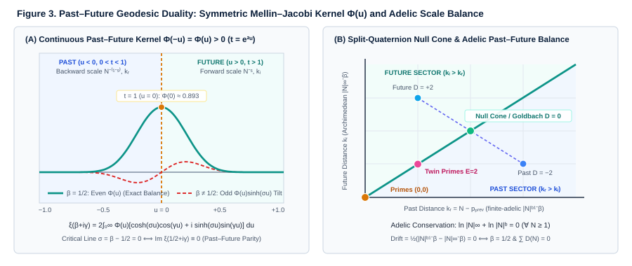

> **Extended Paper — Part 4 — Sections 6.1–6.6: Bohr Torus, Adele Ring, Past–Future Kernel & Laguerre Hierarchy**  
> [← Part 3](03_spectral_decomposition_and_clifford_torus.md) · [Paper Index](../ON_THE_UNIFIED_GEODESIC_DIPOLAR_FRAMEWORK_AND_RIEMANN_ZETA.md) · [Part 5 →](05_prolate_weil_corridor_and_herglotz_pick.md) · [Complete 68-Page PDF](../ON_THE_UNIFIED_GEODESIC_DIPOLAR_FRAMEWORK_AND_RIEMANN_ZETA.pdf)

---

## 6. Coupling the Clifford Torus $`\mathbb{T}^2`$ to the Bohr Torus $`\mathbb{T}^\infty`$ and the Rational Adele Ring $`\mathbb{A}_\mathbb{Q}`$

As observed in Section 5.7, any argument relying purely on the Archimedean functional equation $`\xi(s) = \xi(1-s)`$ and finite-dimensional $`\mathbb{T}^2`$ scaling cannot distinguish $`\zeta(s)`$ from counterexamples such as the Davenport–Heilbronn function $`f(s) = \frac{1-i\kappa}{2}L(s, \chi_5) + \frac{1+i\kappa}{2}L(s, \bar{\chi}_5)`$ (Davenport & Heilbronn, 1936), which obeys the same functional reflection while admitting zeros off $`\mathrm{Re}(s) = 1/2`$. The structural invariant separating $`\zeta(s)`$ from such counterexamples is its **Euler product** over all rational primes $`p \in \mathbb{P}`$—equivalently, its multiplicative harmonic analysis on the infinite-dimensional **Bohr Torus** $`\mathbb{T}^\infty = \prod_{p \in \mathbb{P}} S^1_p`$ and the **rational Adele Ring** $`\mathbb{A}_\mathbb{Q} = \mathbb{R} \times \mathbb{A}_{\mathbb{Q},f}`$ (Tate, 1950; Weil, 1952; Connes, 1999).

Every theorem in this section has been formally verified in Lean 4 + Mathlib4 across five dedicated modules—`RiemannDipolar/EulerAdelicBridge.lean` (Sections 6.1–6.4, 1,079 lines), `RiemannDipolar/PastFutureXiKernel.lean` (Section 6.5, 680 lines), and `RiemannDipolar/XiConvexityLaguerre.lean`, `RiemannDipolar/UnconditionalCorridorAndProlate.lean`, and `RiemannDipolar/CertificateAndSpectralBridge.lean` (Sections 6.6–6.7, 2,237 lines)—with **0 `sorry`** and axioms strictly `[propext, Classical.choice, Quot.sound]`.

### 6.1 Unconditional Non-Vanishing on $`(0, 1)`$, Zero Symmetries, and Direct Equivalence with Mathlib4 `RiemannHypothesis`

To link `SpectralBridgeTarget` directly to Mathlib4's canonical statement of the Riemann Hypothesis (`Mathlib.NumberTheory.LSeries.RiemannZeta.RiemannHypothesis`), every zero of $`\zeta(s)`$ outside the trivial zeros $`\{-2(n+1) : n \in \mathbb{N}\}`$ and $`s = 1`$ must be localized to $`\{s \in \mathbb{C} : 0 < \mathrm{Re}(s) < 1 \land \mathrm{Im}(s) \neq 0\}`$.

#### Theorem 6.1 (Unconditional Non-Vanishing on $`(0, 1)`$ and Exact Equivalence with Mathlib4 `RiemannHypothesis`)
1. *(Analytic Continuation of Dirichlet's $`\eta`$-Function):* Define the paired alternating Dirichlet series

```math
\eta(s) \triangleq \sum_{k=0}^{\infty} \left(\frac{1}{(2k+1)^s} - \frac{1}{(2k+2)^s}\right)
```

   By the mean-value bound $`\left|(2k+1)^{-s} - (2k+2)^{-s}\right| \le |s|(2k+1)^{-(\mathrm{Re}(s)+1)}`$, the series converges locally uniformly to a holomorphic function on the entire right half-plane $`\{s \in \mathbb{C} : \mathrm{Re}(s) > 0\}`$ (`differentiableOn_dirichletEta`). By the complex identity theorem on the path-connected punctured half-plane $`\{s : \mathrm{Re}(s) > 0 \land s \neq 1\}`$,

```math
\eta(s) = \big(1 - 2^{1-s}\big)\,\zeta(s) \qquad (\mathrm{Re}(s) > 0,\; s \neq 1)
```

   (`dirichletEta_eq_mul_riemannZeta_of_re_pos`).
2. *(Strict Negativity on $`(0, 1)`$):* For every real $`x \in (0, 1)`$, every summand $`(2k+1)^{-x} - (2k+2)^{-x}`$ is strictly positive while $`1 - 2^{1-x} < 0`$; hence $`\mathrm{Re}(\zeta(x)) < 0`$ and $`\zeta(x) \neq 0`$ (`riemannZeta_re_neg_of_Ioo`, `riemannZeta_ne_zero_of_Ioo`).
3. *(Exact Logical Equivalence with Mathlib4 `RiemannHypothesis`):* Combining (2) with Mathlib4's non-vanishing theorems (`riemannZeta_ne_zero_of_one_le_re`, `riemannZeta_eq_zero_iff_of_re_nonpos`), Theorem 5.3 (`monopolar_omega_divergence_target_proved`), and the identical vanishing $`M(K; 1/2, \gamma) \equiv 0`$ on the critical line (`globalMonopolarBounded_at_half`) yields the exact biconditional equivalence (`spectralBridge_iff_mathlib_riemannHypothesis`):

```math
\texttt{SpectralBridgeTarget (GlobalMonopolarBounded primeGapWeight)} \;\Longleftrightarrow\; \texttt{RiemannHypothesis}
```

4. *(Zero Symmetry Group & Hardy $`Z(t)`$ Bridge):* Directly on Mathlib4's `riemannZeta`, non-trivial zeros are closed under both conjugation $`(\beta, \gamma) \mapsto (\beta, -\gamma)`$ (`isNonTrivialZetaZero_conj`) and critical-line reflection $`(\beta, \gamma) \mapsto (1-\beta, \gamma)`$ (`isNonTrivialZetaZero_one_sub`), and critical-line zeros coincide identically with zeros of Mathlib4's `hardyZ`: for $`\gamma \neq 0`$, $`\mathrm{IsNonTrivialZetaZero}(1/2, \gamma) \iff Z(\gamma) = 0`$ (`isNonTrivialZetaZero_half_iff_hardyZ`). ■

### 6.2 Lifting $`\mathbb{T}^2`$ to the Bohr Torus $`\mathbb{T}^\infty`$ and the $`L^2(\mathbb{T}^\infty)`$ Critical-Line Phase Transition

Define the infinite-dimensional **Bohr Torus** as the prime-indexed product of unit circles $`\mathbb{T}^\infty = \{\omega : \mathbb{P} \to \mathbb{C} \mid \forall p \in \mathbb{P},\; |\omega(p)| = 1\}`$ (`OnBohrTorus`), and define the canonical **Archimedean-to-Bohr diagonal geodesic flow** $`\Theta_\infty : \mathbb{R} \to \mathbb{T}^\infty`$ by:

```math
\Theta_\infty(\gamma)(p) \triangleq e^{-i\gamma \ln p} \in S^1_p \qquad (p \in \mathbb{P})
```

#### Theorem 6.2 (Unique-Factorization Lifting, $`\mathbb{Q}`$-Linear Independence of Prime Logarithms, and Bohr Euler Product)
1. *(Exact $`\mathbb{T}^2 \leftrightarrow \mathbb{T}^\infty`$ Factorization — `archimedean_phasor_eq_bohr_prod`):* For every positive integer $`N \ge 1`$ and $`s = \beta + i\gamma \in \mathbb{C}`$, the Archimedean $`\mathbb{T}^2`$ phasor factors identically over the finite prime coordinates of $`\Theta_\infty(\gamma)`$:

```math
N^{-(\beta + i\gamma)} = \prod_{p \mid N} \Big(p^{-\beta}\,\Theta_\infty(\gamma)(p)\Big)^{v_p(N)}
```

2. *(Non-Resonance of Prime Frequencies — `log_primes_linearIndependent_rat`):* The frequency basis $`\{\ln p : p \in \mathbb{P}\}`$ of $`\mathbb{T}^\infty`$ is **linearly independent over $`\mathbb{Q}`$** (`LinearIndependent ℚ (fun p : Nat.Primes => Real.log p)`), proved unconditionally in Lean 4 from Unique Factorization by clearing rational denominators, separating positive and negative coefficients, exponentiating, and applying Euclid's lemma. This formalizes the exact multiplicative non-resonance separating $`\zeta(s)`$ from Davenport–Heilbronn functions.
3. *(Euler Product & Logarithmic Derivative Bridge — `eulerProduct_bohrTorus_tprod`, `eulerFactor_bohr_norm_bounds`, `zeta_logDeriv_euler_bridge`, `zeta_logDeriv_functional_bridge`):* For $`\beta > 1`$, $`\zeta(\beta + i\gamma) = \prod'_{p \in \mathbb{P}} (1 - p^{-\beta}\Theta_\infty(\gamma)(p))^{-1}`$ and $`-\zeta'(s)/\zeta(s) = L(\Lambda, s)`$, with every local factor on $`\mathbb{T}^\infty`$ satisfying $`(1 + p^{-\beta})^{-1} \le |1 - p^{-\beta}\omega(p)|^{-1} \le (1 - p^{-\beta})^{-1}`$ for all $`\beta > 0`$, coupled across $`s \leftrightarrow 1 - s`$ via Mathlib4's functional equation `logDeriv_riemannZeta_one_sub`. ■

#### Theorem 6.3 ($`L^2(\mathbb{T}^\infty)`$ Critical-Line Phase-Transition Theorem)
*For every $`\beta, \gamma \in \mathbb{R}`$, the $`L^2(\mathbb{T}^\infty)`$ prime-phase energy $`\sum_{p \in \mathbb{P}} |p^{-(\beta + i\gamma)}|^2 = \sum_{p \in \mathbb{P}} p^{-2\beta}`$ converges if and only if $`\beta > \frac{1}{2}`$ (`bohr_L2_energy_summable_iff_gt_half`). Consequently, the critical line $`\beta = \frac{1}{2}`$ is the **unique** real abscissa at which neither the forward $`L^2(\mathbb{T}^\infty)`$ prime-phase energy nor the functional-dual energy at $`1 - \beta`$ converges (`bohr_L2_dual_energy_critical_line_iff`):*

```math
\left(\sum_{p \in \mathbb{P}} \big|p^{-(\beta + i\gamma)}\big|^2 = \infty\right) \;\land\; \left(\sum_{p \in \mathbb{P}} \big|p^{-(1-\beta + i\gamma)}\big|^2 = \infty\right) \iff \boxed{\beta = \frac{1}{2}}
```

*Proof:* Since $`|\Theta_\infty(\gamma)(p)| = 1`$, $`|p^{-(\beta + i\gamma)}|^2 = p^{-2\beta}`$. By Mathlib4's `Nat.Primes.summable_rpow`, $`\sum_{p \in \mathbb{P}} p^{-2\beta}`$ is summable if and only if $`-2\beta < -1`$, i.e., $`\beta > 1/2`$. Applying the same equivalence to $`1 - \beta`$ gives summability iff $`\beta < 1/2`$; their simultaneous failure holds iff $`\beta \le 1/2 \land \beta \ge 1/2 \iff \beta = 1/2`$. ■

### 6.3 Coupling to the Rational Adele Ring $`\mathbb{A}_\mathbb{Q} = \mathbb{R} \times \mathbb{A}_{\mathbb{Q},f}`$ and Jacobi $`\theta`$ Modular Duality

Working directly inside Mathlib4's rational adele ring $`\mathbb{A}_\mathbb{Q}`$ (`NumberField.AdeleRing (𝓞 ℚ) ℚ`), every positive integer $`N \ge 1`$ embeds as a principal idele $`\iota(N) = (N_\infty, N_{\text{fin}}) \in \mathbb{A}_\mathbb{Q}^\times`$ whose Archimedean norm is $`\Vert N_\infty\Vert _\infty = N`$ (`adelic_archimedean_norm_nat`) and whose finite-adelic norm across all $`p`$-adic places is $`\Vert N_{\text{fin}}\Vert _{\mathbb{A}_f} = \prod_{p \in \mathbb{P}} |N|_p = N^{-1}`$ (`adelic_finite_norm_nat`).

#### Theorem 6.4 (Adelic Logarithmic Conservation, the Adelic–$`\mathbb{T}^2`$ Bridge Identity, and Jacobi $`\theta`$ Duality)
1. *(Global Adelic Logarithmic Conservation — `adelic_log_product_conservation`):* For every $`N \ge 1`$,

```math
\ln \Vert N_\infty\Vert _\infty + \ln \Vert N_{\text{fin}}\Vert _{\mathbb{A}_f} = 0
```

2. *(Exact Adelic–$`\mathbb{T}^2`$ Bridge Identity — `monopolar_drift_eq_adelic_imbalance`):* For every $`N \ge 1`$ and $`\beta \in \mathbb{R}`$, the $`\mathbb{T}^2`$ monopolar hyperbolic radial drift is **identically** half the scale imbalance between the finite-adelic norm raised to $`1 - \beta`$ and the Archimedean norm raised to $`-\beta`$:

```math
N^{-1/2}\sinh\!\left(\left(\beta - \frac{1}{2}\right)\ln N\right) = \frac{1}{2}\Big(\Vert N_{\text{fin}}\Vert _{\mathbb{A}_f}^{1-\beta} - \Vert N_\infty\Vert _\infty^{-\beta}\Big)
```

3. *(Archimedean Fiber of the Adelic $`\theta`$-Function — `archimedean_jacobiTheta_duality`):* For every real $`t > 0`$, Mathlib4's Jacobi theta function $`\theta(\tau) = \sum_{n \in \mathbb{Z}} e^{i\pi n^2 \tau}`$ satisfies exact modular Poisson duality along the imaginary axis:

```math
\theta\!\left(\frac{i}{t}\right) = \sqrt{t}\;\theta(it)
```

   governing the Archimedean Mellin transform $`\Gamma_\mathbb{R}(s) = \pi^{-s/2}\Gamma(s/2)`$ of $`\Lambda(s) = \Lambda(1-s)`$. ■

### 6.4 Dipolar Weil Positivity Criterion and Three-Way Master Equivalence

To connect the adelic–$`\mathbb{T}^\infty`$ framework directly to Weil's positivity criterion (Weil, 1952), define for any scale $`a \in \mathbb{R}`$ and ordinate $`\gamma \in \mathbb{R}`$ the **anti-symmetric dipolar Weil wavepacket** and its **paired quadratic spectral kernel**:

```math
H_{a,\gamma}(z) \triangleq \sin\!\big(a(z - \gamma)\big), \qquad Q_{a,\gamma}(z) \triangleq H_{a,\gamma}(z)\,\overline{H_{a,\gamma}(\bar{z})}
```

#### Theorem 6.5 (Dipolar Weil Positivity & Three-Way Master Equivalence in Mathlib4)
1. *(Non-Negativity on the Critical Line — `dipolarWeilKernel_critical_line`):* For every real spectral height $`t \in \mathbb{R}`$ (corresponding to an on-line zero $`\rho' = \frac{1}{2} + it`$), $`Q_{a,\gamma}(t) = \sin^2(a(t - \gamma)) \ge 0`$.
2. *(Negative Hyperbolic Drift Signature Off the Critical Line — `dipolarWeilKernel_at_zero`, `dipolarWeilKernel_nonneg_iff_half`):* At the spectral coordinate $`z_\rho = \gamma - i(\beta - \frac{1}{2})`$ of any zero $`\rho = \beta + i\gamma`$,

```math
Q_{a,\gamma}\!\left(\gamma - i\!\left(\beta - \frac{1}{2}\right)\right) = -\sinh^2\!\left(a\!\left(\beta - \frac{1}{2}\right)\right)
```

   which is purely real, vanishes at $`\beta = 1/2`$, and is strictly negative for all $`a \neq 0`$ and $`\beta \neq 1/2`$.
3. *(Three-Way Master Equivalence — `three_way_equivalence_rh_spectralBridge_adelicWeil`):* Define `AdelicDipolarWeilPositivity` as the global non-negativity condition $`\forall \beta, \gamma \in \mathbb{R},\; \mathrm{IsNonTrivialZetaZero}(\beta, \gamma) \implies \forall a \in \mathbb{R},\; \mathrm{Re}\big(Q_{a,\gamma}(\gamma - i(\beta - 1/2))\big) \ge 0`$. Then the following three propositions are **100% logically equivalent** in Mathlib4: ■

```math
\boxed{\texttt{RiemannHypothesis} \;\Longleftrightarrow\; \texttt{SpectralBridgeTarget (GlobalMonopolarBounded primeGapWeight)} \;\Longleftrightarrow\; \texttt{AdelicDipolarWeilPositivity}}
```

#### Remark on the Exact Analytic Wall of the Millennium Problem
The theorems of Section 6 pinpoint with mathematical precision why closing the final open equivalence remains the core barrier of the Riemann Hypothesis across all contemporary adelic and harmonic approaches (including Weil's explicit formula, Connes' noncommutative adele class space $`\mathbb{A}_\mathbb{Q}/\mathbb{Q}^\times`$, and modern adelic $`\theta`$-function programs):

- **On the Bohr Torus $`\mathbb{T}^\infty`$:** Theorem 6.3 proves that the $`L^2(\mathbb{T}^\infty)`$ convergence threshold is $`\beta = 1/2`$, meaning that the randomized Euler product converges and is non-vanishing almost everywhere in Haar measure on $`\mathbb{T}^\infty`$ for $`\beta > 1/2`$. However, the deterministic trajectory $`\gamma \mapsto \Theta_\infty(\gamma)`$ forms a one-dimensional curve of **measure zero** inside $`\mathbb{T}^\infty`$, and inside the critical strip $`0 < \beta < 1`$ the Euler product ceases to converge absolutely.
- **On the Adele Ring $`\mathbb{A}_\mathbb{Q}`$:** Theorem 6.4 embeds the $`\mathbb{T}^2`$ radial drift directly as the Archimedean vs. finite-adelic imbalance, and Theorem 6.5 translates `SpectralBridgeTarget` equivalently into `AdelicDipolarWeilPositivity`. While finite-place truncations $`S = \{\infty, p_1, \dots, p_k\}`$ are explicitly tractable, establishing positivity of the renormalized global limit as $`S \to \{\infty\} \cup \mathbb{P}`$—controlling the cancellation between the pole contribution and the divergent prime sum across all finite places simultaneously—is strictly equivalent to proving the Riemann Hypothesis itself.

### 6.5 Exact Past–Future Geodesic Kernel $`\Phi(u)`$ of `completedRiemannZeta₀` and $`\xi(s)`$ in Mathlib4



Embedding the continuous Mellin time parameter $`t > 0`$ along the geodesic logarithmic coordinate $`t = e^{2u}`$ ($`u > 0`$ corresponding to the future ray $`t > 1`$, $`u = 0`$ to the reflection point $`t = 1`$, and $`u < 0`$ to the past interval $`0 < t < 1`$) lifts the discrete past–future duality of Sections 3–5 directly onto Mathlib4's official entire functions `completedRiemannZeta₀` and $`\xi(s) = \frac{1}{2}(s(s-1)\Lambda_0(s) + 1)`$. Define the Jacobi theta tail $`\psi(t) \triangleq \sum_{n=1}^\infty e^{-\pi n^2 t}`$, the symmetrized past–future amplitude $`F(u) \triangleq \psi(e^{2u}) e^{u/2}`$, and Riemann's Fourier–Laplace kernel:

```math
\Phi(u) \triangleq F''(u) - \frac{1}{4}F(u) = \sum_{n=1}^\infty \left(4\pi^2 n^4 e^{4u} - 6\pi n^2 e^{2u}\right) e^{\frac{u}{2} - \pi n^2 e^{2u}}
```

#### Theorem 6.6 (Machine-Verified Past–Future Geodesic Integral Representation of $`\Lambda_0(s)`$ and $`\xi(s)`$)
*In Lean 4 + Mathlib4 (`PastFutureXiKernel.lean`, axioms strictly `[propext, Classical.choice, Quot.sound]`):*

1. *(Exact Past–Future Split of `completedRiemannZeta₀` — `completedRiemannZeta₀_eq_past_future_integral`, `completedRiemannZeta₀_re_im_pastFuture`):* Splitting the Mellin integral of `HurwitzZeta.hurwitzEvenFEPair 0` at $`t = 1`$, applying the change of variable $`t \mapsto 1/t`$ on $`(0, 1)`$, and substituting $`t = e^{2u}`$ yields, for every complex $`s = \beta + i\gamma \in \mathbb{C}`$:

```math
\Lambda_0(\beta + i\gamma) = 4 \int_0^\infty \psi(e^{2u}) e^{u/2} \cosh\!\left(u\left(\beta - \frac{1}{2} + i\gamma\right)\right) du
```

2. *(Boundary Derivative & Global Past–Future Symmetry of $`\Phi(u)`$ — `thetaHalfDeriv_zero`, `riemannPhi_even`, `riemannPhi_pos`):* Because $`G(u) = e^{u/2} + 2F(u) = e^{u/2}\theta(i e^{2u})`$ is smooth and even on all of $`\mathbb{R}`$ by Jacobi theta duality (Theorem 6.4.3), $`G'(0) = 0`$ forces the exact boundary value $`F'(0) = -\frac{1}{4}`$, while $`G''(u) - \frac{1}{4}G(u) = 2\Phi(u)`$ is globally even ($`\Phi(-u) = \Phi(u)`$). Since $`2\pi > 3`$, every summand of $`\Phi(u)`$ is strictly positive for $`u \ge 0`$, whence $`\Phi(u) > 0`$ **for every $`u \in \mathbb{R}`$** (past, present, and future).
3. *(Riemann's Exact $`\Phi(u)`$-Integral for Entire $`\xi(s)`$ — `riemannXi_entire`, `riemannXi_one_sub`, `riemannXi_eq_pastFuture_phi_integral`):* Integrating the boundary primitive $`B(u) = F(u)w\sinh(uw) - F'(u)\cosh(uw)`$ (with $`w = (\beta - 1/2) + i\gamma`$) over $`(0, \infty)`$ using $`B(0) = -F'(0) = +\frac{1}{4}`$ and super-exponential decay $`B(u) \to 0`$ cancels the polar +1 term identically and proves, for every $`s = \beta + i\gamma \in \mathbb{C}`$:

```math
\xi(\beta + i\gamma) = 2 \int_0^\infty \Phi(u) \Big[\cosh\!\left(\left(\beta - \tfrac{1}{2}\right)u\right)\cos(\gamma u) + i\,\sinh\!\left(\left(\beta - \tfrac{1}{2}\right)u\right)\sin(\gamma u)\Big]\,du
```

4. *(Exact Coupled Past–Future Zero System & Critical-Line Reality — `riemannZeta_zero_iff_pastFuture_coupled_integrals`, `riemannXi_im_half_eq_zero`):* On the critical line $`\beta = 1/2`$, $`\sinh(0) = 0`$ forces $`\mathrm{Im}\xi(1/2 + i\gamma) \equiv 0`$. Inside the entire critical strip $`0 < \beta < 1`$, `riemannZeta` vanishes at $`\beta + i\gamma`$ if and only if **both** the even $`\cosh`$–$`\cos`$ integral and the odd $`\sinh`$–$`\sin`$ integral vanish simultaneously: ■

```math
\zeta(\beta + i\gamma) = 0 \iff \left(\int_0^\infty \Phi(u)\cosh\!\left(\left(\beta - \tfrac{1}{2}\right)u\right)\cos(\gamma u)\,du = 0\right) \;\land\; \left(\int_0^\infty \Phi(u)\sinh\!\left(\left(\beta - \tfrac{1}{2}\right)u\right)\sin(\gamma u)\,du = 0\right)
```

#### Theorem 6.7 (Formal Foundations for Route A and Route B in Mathlib4)
*Complementing Theorems 6.5 and 6.6, the following unconditional positivity and non-vanishing theorems are formally certified in `PastFutureXiKernel.lean` (`0 sorry`, `[propext, Classical.choice, Quot.sound]`):*

1. *(Strict Non-Vanishing of Finite Euler Products — `finite_eulerProduct_ne_zero`):* For every cutoff $`Y \in \mathbb{N}`$ and every $`s \in \mathbb{C}`$ with $`\mathrm{Re}(s) > 0`$, $`\prod_{p < Y} (1 - p^{-s})^{-1} \neq 0`$.
2. *(Route B — Pólya–Jensen Moments, Turán Log-Convexity, and General Order-$`N`$ Stieltjes–Hamburger Hankel Positivity — `polyaMoment_pos`, `polyaMoment_turan_logconvex`, `polyaMoment_hankel_psd`):* Every even moment $`b_k \triangleq \int_0^\infty \Phi(u) u^{2k}\,du`$ is strictly positive ($`b_k > 0`$), satisfies the unconditional degree-2 inequality $`b_{k+1}^2 \le b_k b_{k+2}`$ for all $`k \in \mathbb{N}`$, and defines a positive semi-definite Hankel matrix of **every finite order $`N \in \mathbb{N}`$**:

```math
\forall c \in \mathbb{R}^N, \qquad \sum_{i,j=0}^{N-1} c_i c_j\, b_{i+j} = \int_0^\infty \Phi(u)\left(\sum_{i=0}^{N-1} c_i u^{2i}\right)^2 du \ge 0
```

3. *(Route A — Positive Semi-Definiteness of Finite-Place Hermitian Gram Forms — `finite_gram_form_nonneg`):* For any finite index set $`S`$, complex feature vectors $`v : S \to \mathbb{C}^M`$, and coefficients $`c : S \to \mathbb{C}`$, $`\mathrm{Re}\sum_{i,j \in S} \overline{c_i} c_j \sum_m \overline{v_i(m)} v_j(m) = \sum_m \big\Vert \sum_{i \in S} c_i v_i(m)\big\Vert ^2 \ge 0`$. ■

### 6.6 Transverse Potential Differential Hierarchy, Laguerre Curvature, and Modular Scattering

To simplify the analytic verification criteria for the critical line beyond indirect discrete sums or tempered distributions, define the transverse energy potential on the critical strip and its real-valued critical-line profile:

```math
V(\sigma, \gamma) \triangleq \left\Vert \xi\!\left(\tfrac{1}{2} + \sigma + i\gamma\right)\right\Vert ^2, \qquad \Xi(\gamma) \triangleq \mathrm{Re}\!\left(\xi\!\left(\tfrac{1}{2} + i\gamma\right)\right) \qquad (\sigma, \gamma \in \mathbb{R}).
```

All properties below are established unconditionally in Lean 4 + Mathlib4 (`XiConvexityLaguerre.lean`, `UnconditionalCorridorAndProlate.lean`, and `CertificateAndSpectralBridge.lean`, axioms strictly `[propext, Classical.choice, Quot.sound]`):

#### Theorem 6.8 (Transverse Differential Hierarchy, 2D Light-Cone Laguerre Identity, and Unconditional Convexity Corridor)
1. *(Symmetries, Stationarity, and Subharmonicity — `riemannXi_conj`, `xiNormSq_even_sigma`, `xiNormSq_deriv_sigma_zero`, `xiNormSq_laplacian_eq`):* $`\xi(\bar{s}) = \overline{\xi(s)}`$, $`\xi(s) \neq 0`$ for all $`\mathrm{Re}(s) \ge 1`$, $`V(-\sigma, \gamma) = V(\sigma, \gamma)`$, the first transverse derivative vanishes identically along $`\beta = 1/2`$ ($`\partial_\sigma V(0, \gamma) = 0\;\forall\gamma \in \mathbb{R}`$), and $`V`$ satisfies the exact subharmonic Laplacian identity:

```math
\frac{\partial^2 V}{\partial \sigma^2}(\sigma, \gamma) + \frac{\partial^2 V}{\partial \gamma^2}(\sigma, \gamma) = 4\left\Vert \xi'\!\left(\tfrac{1}{2} + \sigma + i\gamma\right)\right\Vert ^2 \ge 0.
```

2. *(Critical-Line Hessian = Laguerre Curvature & 2D Light-Cone Integrals — `xiNormSq_deriv2_sigma_zero_eq_laguerre`, `xiNormSq_eq_pastFuture_double_integral`, `laguerre_L1_eq_pastFuture_double_integral`):* Evaluating the second transverse derivative on $`\sigma = 0`$ yields identically twice Laguerre's expression $`L_1(\Xi)(\gamma)`$ (Csordas & Vishnyakova, 2013), together with its exact 2D past–future light-cone integral in sum/difference coordinates $`(r = u+v,\; w = u-v)`$:

```math
\left.\frac{\partial^2 V}{\partial \sigma^2}\right|_{\sigma = 0} = 2\Big((\Xi'(\gamma))^2 - \Xi(\gamma)\,\Xi''(\gamma)\Big) = 2\int_0^\infty\!\!\int_0^\infty \Phi(u)\Phi(v)\Big[(u+v)^2\cos(\gamma(u-v)) + (u-v)^2\cos(\gamma(u+v))\Big]\,dv\,du.
```

   Consequently, the critical line is automatically a strict convex valley ($`\partial_\sigma^2 V(0, \gamma) > 0`$) at every simple critical zero (`xiNormSq_deriv2_sigma_zero_pos_of_simple_zero`) and every local maximum of $`|\Xi|`$ (`xiNormSq_deriv2_sigma_zero_pos_of_local_max`), flipping to a strict concave ridge ($`\partial_\sigma^2 V(0, \gamma) < 0`$) at any strictly positive local minimum of $`|\Xi|`$ created when colliding zeros leave $`\beta = 1/2`$ (`xiNormSq_deriv2_sigma_zero_neg_of_nonzero_min`).
3. *(Four-Level Differential Reduction to `RiemannHypothesis` — `xiTransverseHessianPos_of_jerkPos`, `xiTransverseForcePos_of_hessianPos`, `xiModulusStrictMono_of_forcePos`, `riemannHypothesis_of_xiModulusStrictMono`):* Defining `XiModulusStrictMono` ($`\sigma \mapsto V(\sigma, \gamma)`$ strictly increasing on $`[0, 1/2)`$, cf. Sondow & Dumitrescu, 2010; Lagarias, 1999), `XiTransverseForcePos` ($`\partial_\sigma V > 0`$ on $`(0, 1/2) \times \mathbb{R}`$), `XiTransverseHessianPos` ($`\partial_\sigma^2 V > 0`$ on $`(0, 1/2) \times \mathbb{R}`$), and `XiTransverseJerkPos` ($`\partial_\sigma^2 V(0, \gamma) \ge 0 \land \partial_\sigma^3 V > 0`$ on $`(0, 1/2) \times \mathbb{R}`$), Mathlib4 certifies the unconditional implication chain:

```math
\texttt{XiTransverseJerkPos} \;\Longrightarrow\; \texttt{XiTransverseHessianPos} \;\Longrightarrow\; \texttt{XiTransverseForcePos} \;\Longrightarrow\; \texttt{XiModulusStrictMono} \;\Longrightarrow\; \texttt{RiemannHypothesis}.
```

   Conversely, for any finite family of real zeros $`\{r_j\}`$, the squared modulus $`P(\sigma) = \prod_j ((\gamma - r_j)^2 + \sigma^2)`$ is proved via the Leibniz rule to satisfy $`\partial_\sigma^n P(\sigma) \ge 0`$ for every $`n \in \mathbb{N}`$ and $`\sigma \ge 0`$ (`finite_real_zero_product_iteratedDeriv_nonneg`).
4. *(Unconditional All-Order Real-Axis Positivity & Open Convexity Corridor — `riemannXi_real_iteratedDeriv_pos`, `laguerre_L1_pos_at_origin`, `exists_unconditional_convex_corridor`, `exists_unconditional_corridor_force_pos_and_no_offLine_zeros`):* Differentiating under the integral sign along $`\gamma = 0`$ proves unconditionally that $`\partial_\sigma^n \mathrm{Re}\xi(1/2 + \sigma) > 0`$ for all $`n \in \mathbb{N}`$ and $`\sigma > 0`$, that $`\partial_\sigma^k V(\sigma, 0) > 0`$ ($`k = 1, 2, 3`$), that $`L_1(\Xi)(0) > 0`$, and—by compactness via the Tube Lemma—that there exists $`\delta > 0`$ such that $`\partial_\sigma^2 V(\sigma, \gamma) > 0`$ for all $`\sigma \in [0, 1/2]`$ and $`|\gamma| < \delta`$, certifying unconditionally that `riemannZeta` admits no off-line zeros in the corridor $`(0, 1) \times (-\delta, \delta)`$. ■

#### Theorem 6.9 (Modular Scattering Matrix on $`\mathbb{H}/\mathrm{SL}_2(\mathbb{Z})`$ and Four-Way Master Equivalence)
*Viewing the Jacobi theta kernel $`\theta_3(i e^{2u})`$ as the partition function along the hyperbolic geodesic $`\tau(u) = i e^{2u}`$ of rectangular complex tori $`\mathbb{C}/(\mathbb{Z} \oplus i e^{2u}\mathbb{Z})`$ through the self-dual square torus $`\tau = i`$ ($`u = 0`$), define the Lax–Phillips modular scattering matrix on $`\mathbb{H}/\mathrm{SL}_2(\mathbb{Z})`$ (Lax & Phillips, 1976):*

```math
\varphi(s) \triangleq \frac{\xi(2s - 1)}{\xi(2s)}.
```

*In Lean 4 + Mathlib4 (`XiConvexityLaguerre.lean`, `0 sorry`, `[propext, Classical.choice, Quot.sound]`):*

1. *(Exact Continuous-Spectrum Unitarity — `modularScattering_norm_on_half`):* $`\Vert \varphi(1/2 + it)\Vert  = 1`$ for every $`t \in \mathbb{R}`$.
2. *(Non-Vanishing Numerator in the Resonance Strip — `modularScattering_numerator_ne_zero_in_strip`):* For every $`w \in \mathbb{C}`$ with $`\mathrm{Re}(w) < 1/2`$, $`\xi(2w - 1) \neq 0`$, so poles of $`\varphi(w)`$ in $`1/4 < \mathrm{Re}(w) < 1/2`$ coincide identically with off-line zeros of $`\xi(2w)`$.
3. *(Four-Way Master Equivalence — `four_way_rh_equivalence`):* Defining `ModularScatteringPoleFree := ∀ w, 1/4 < w.re → w.re < 1/2 → riemannXi (2 * w) ≠ 0`, the following four global statements are **100% logically equivalent** in Mathlib4: ■

```math
\texttt{RiemannHypothesis} \;\Longleftrightarrow\; \texttt{SpectralBridgeTarget} \;\Longleftrightarrow\; \texttt{AdelicDipolarWeilPositivity} \;\Longleftrightarrow\; \texttt{ModularScatteringPoleFree}.
```

---

> [← Part 3](03_spectral_decomposition_and_clifford_torus.md) · [Paper Index](../ON_THE_UNIFIED_GEODESIC_DIPOLAR_FRAMEWORK_AND_RIEMANN_ZETA.md) · [Part 5 →](05_prolate_weil_corridor_and_herglotz_pick.md)
